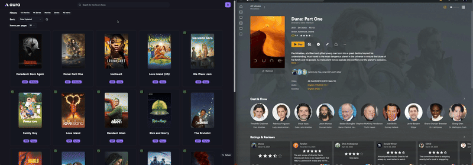
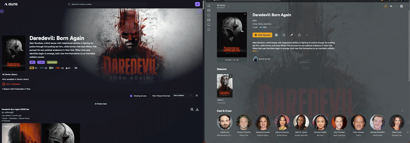

# 

**aura** (Automated Utility for Retrieval of Assets) is a visual tool for managing MediUX image assets for your media server. It provides a sleek and intuitive interface to browse, preview, and apply image sets to your library content across platforms like Plex, Emby, and Jellyfin.

> **Note:** This tool is currently in beta. While it has been tested locally, please use it at your own risk.

---

## Key Features

- 🧩 **Cross-Server Compatibility**: Works with Plex, Emby, and Jellyfin.
- 🖼 **Visual Browsing**: Preview artwork in a clean, organized interface.
- 🔁 **Automated Updates**: Save selected image sets and keep them synced automatically.
- 🗄 **Local Storage**: Option to store images next to your media files for easy access.
- 📦 **Docker Support**: Easily deploy using Docker or docker-compose.

---

## Demo

**Check out the demo of aura in action! You can see how it looks and works before installing.**

Movie being processed and the results in Plex

Series being processed and the results in Plex

---

## Getting Started

To get started with aura:

1. Install using Docker or docker-compose.
2. Visit the web UI at `http://localhost:3000`.
3. Configure the application during the onboarding setup.
4. Browse your media server's contents.
5. Choose and apply MediUX image sets.
6. Optionally save selections for automatic updates.

> Visit the [Docs](https://mediux-team.github.io/AURA/) for detailed steps.

> **Note:** In order to get an API token for testing, please join the Discord below. Once you have joined, make your way to repo-chats > mediux-team/aura. There is a pinned message that contains a shared token you can use for testing. Once the new MediUX site is live, you will be able to have your own token.

---

## Join the Community

- 💬 [Join our Discord](https://discord.gg/YAKzwKPwyw)

---

## Support aura

If aura is useful to you, you can support its development:

---

AI Disclaimer:
While most of the code in this repository was written by hand, some of the PR's have been generated with the help of AI tools.
