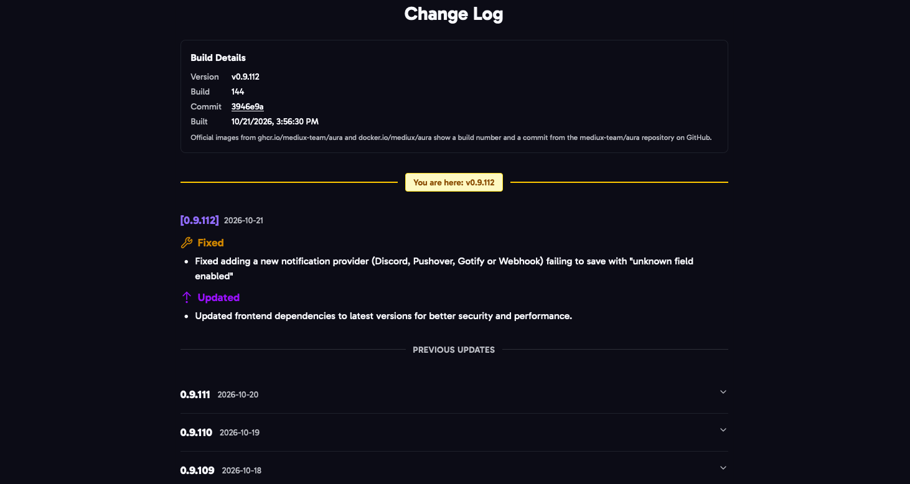

Click the version in the footer of any page to open the **Change Log**. It lists what changed in each version, with the version you're running highlighted.

## Build Details

The top of the Change Log shows exactly what you're running:

- **Version**: for example `v0.9.112`.
- **Build**: the build number of the official image.
- **Commit**: the code the image was built from. Click it to see that commit on GitHub.
- **Built**: when the image was built.

Official images from `ghcr.io/mediux-team/aura` and `docker.io/mediux/aura` always show a build number and a commit from the [mediux-team/aura](https://github.com/mediux-team/aura) repository. An image you build yourself says it was built without build details.

## Updates

When a newer version is out, the footer shows **Update Available** next to your version. Click it to see what's changed since your version. To update, see [Docker Compose](/AURA/installation/docker-compose/#updating).
