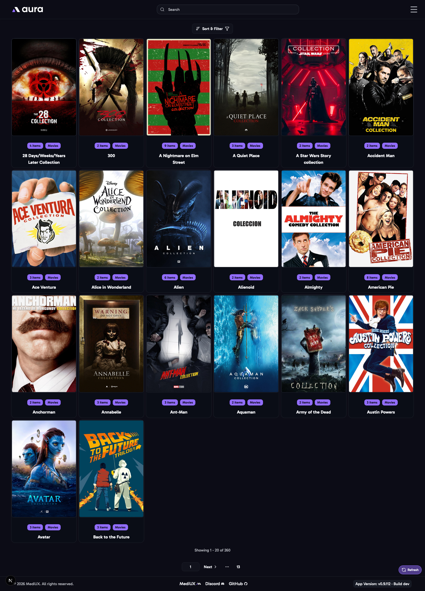
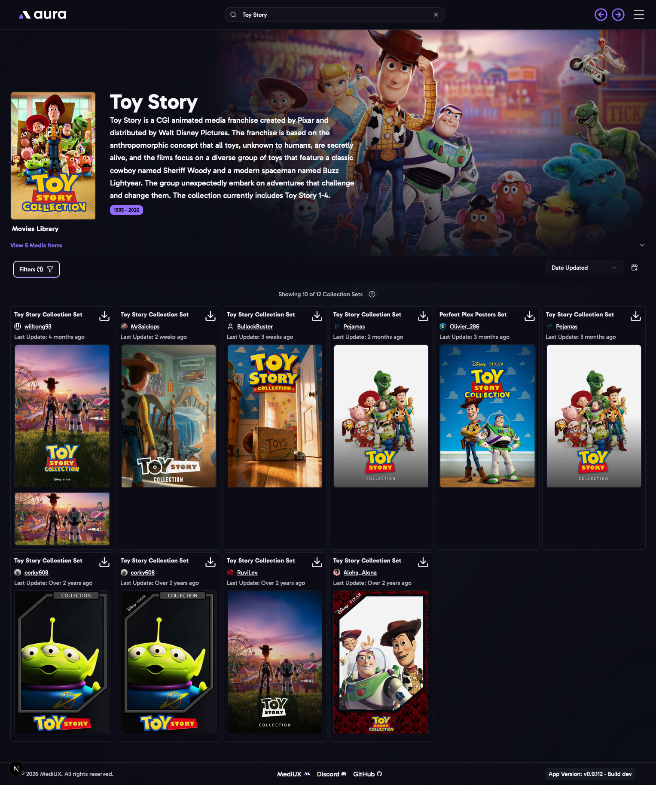

import { Aside } from "@astrojs/starlight/components";

The **Collections** page lists the movie collections on your main media server, such as the Harry Potter or Toy Story collections. Click one to open it.

## Sort & Filter

- **Sort** by **Title**, or by **Number of Items** in the collection.
- **Library Sections**: which libraries to show.
- What you type in the search bar filters the collections by title or year.

## A Collection

A collection's page shows its details and the movies in it, then the MediUX sets with images for the **collection itself**: a **Collection Poster** and a **Collection Backdrop**. These are the images your media server shows for the collection, not for the movies in it.

- **Sort** the sets by **Date Updated**, **User Name** or **Popularity**.
- **Show Hidden Users**: also show sets from creators you've hidden on MediUX.
- Click a set's download button to choose its collection poster or backdrop, and apply them to the collection.

<Aside>
  Collection images are only applied on the main media server. To apply images to the movies in a collection, use a
  **collection set** from one of the movies' [Media Item](/AURA/how-to-use/media-item/) pages, or from a [creator's
  page](/AURA/how-to-use/creator/).
</Aside>
