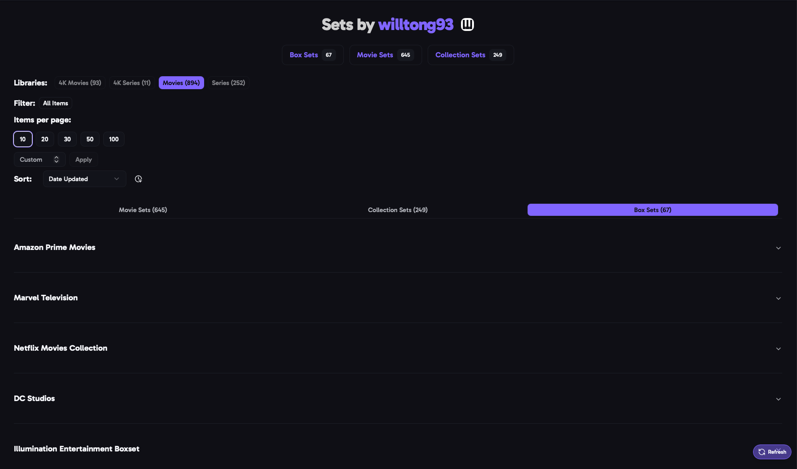

import { Aside } from "@astrojs/starlight/components";

A creator's page shows the sets they've made on MediUX for the items in your libraries. Open it by clicking a creator's name on a set, or by searching for them.

Choose one of your libraries at the top. Each library shows how many of the creator's sets match its items.

## Set Types

The tabs split the creator's sets by type, with how many of each:

| Tab                 | What's in it                                                                                    |
| ------------------- | ----------------------------------------------------------------------------------------------- |
| **Show Sets**       | A poster, backdrop, season posters and title cards for one show.                                |
| **Movie Sets**      | A poster and backdrop for one movie.                                                            |
| **Collection Sets** | Posters and backdrops for every movie in a collection, such as the Toy Story movies.          |
| **Box Sets**        | A group of the creator's show, movie and collection sets, such as a Disney or Marvel boxset.   |

Download a whole boxset at once with its download button. Each set in it is saved on its own in [Saved Sets](/AURA/how-to-use/saved-sets/).

## Sort & Filter

- **Search**: what you type in the search bar matches set titles, and the titles of the items in a set.
- **In-Database Filter**: only sets for items that are **in the database**, **not in the database**, or **in the database with another set**.
- **Sort** by **Date Updated** or **Title**.

<Aside>
  Add creators you like to your [favorite creators](/AURA/settings/user-preferences/#favorite-creators--automatic-downloads)
  to have aura download their sets for you.
</Aside>
