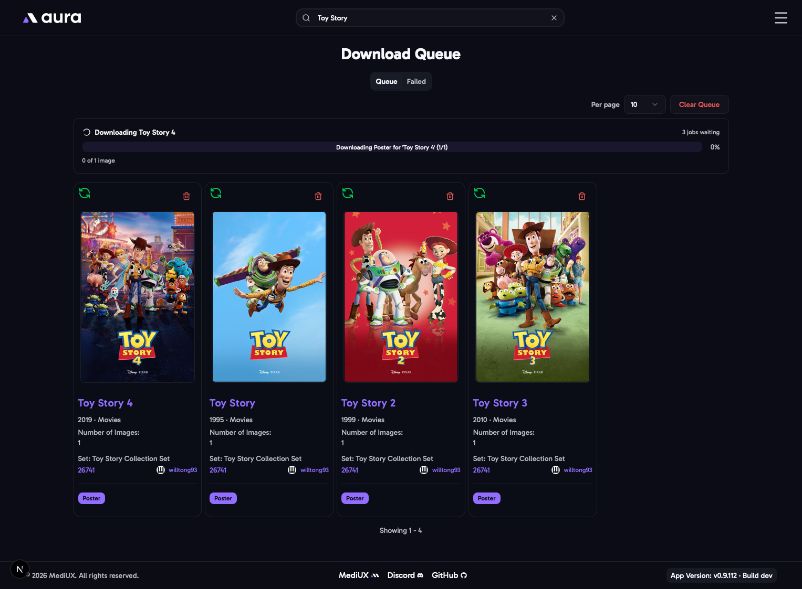
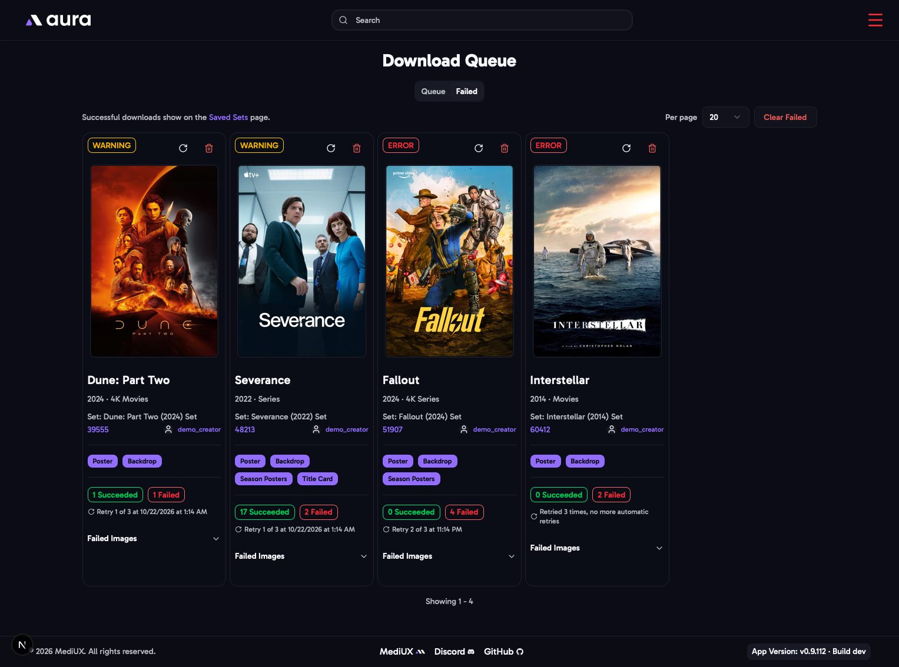

import { Aside } from "@astrojs/starlight/components";

The Download Queue runs every download in the background, starting as soon as a set is added. Several sets download at once, and each of them downloads several images at once, both set by [Simultaneous Downloads](/AURA/settings/mediux/#simultaneous-downloads).

Sets end up here from:

- The [download window](/AURA/how-to-use/downloading-sets/). These go before the downloads aura starts by itself.
- **Auto Download**, with only the images that are new or changed.
- The [Sonarr webhook](/AURA/sonarr-webhook-integration/) and the Plex listener, with only the images to apply again.
- Upgrades, your [favorite creators](/AURA/settings/user-preferences/#favorite-creators--automatic-downloads) and the Silo plugin.
- **Redownload** on the [Saved Sets](/AURA/how-to-use/saved-sets/) page, and retries of failed downloads.

## Queue

The sets waiting to download, and the ones downloading now. Each set downloading has its own progress, with a line for each image downloading. A collection's own poster and backdrop, queued from a [collection set](/AURA/how-to-use/downloading-sets/#collection-images), have their own entry, shown with the collection's name and poster.

Each entry shows what added it, like **Download window**, **Auto Download** or **Retry**. Use **Source** to only show the sets from one of them.

Each image is saved as soon as it downloads. An image that fails isn't saved, so the set keeps what it had before, and the next Auto Download check tries it again.

Each entry's **⋯** menu has:

- **Move to Top** makes a waiting set the next one to download.
- **Remove** takes a set out of the queue. A set that's downloading stops.

**Clear Queue** removes everything that's waiting, and stops the sets downloading.

When a set stops, the images already downloading finish, and the rest aren't downloaded. The images that finished are saved, the rest aren't.

Two sets for the same item never download at the same time. The second one waits until the first finishes.

## Failed

Sets that couldn't be downloaded, with the reason. When downloads have failed, the menu icon turns red and shows how many.

aura retries a failed download by itself, up to 3 times, waiting longer each time: 5 minutes, then 30 minutes, then 2 hours. Each entry shows when the next retry is, or that there are no more retries.

Each entry's **⋯** menu has:

- **Retry** adds the set to the queue again straight away, with its latest images from MediUX. Only the images that failed are downloaded.
- **Delete** removes the entry.

**Clear Failed** removes every failed entry.

<Aside>
  If a download keeps failing, look for it on the [Logs](/AURA/how-to-use/logs/) page, or attach a [Debug
  Bundle](/AURA/settings/advanced/#debug-bundle) when you ask for help.
</Aside>

Both tabs have paging, and remember how many entries you show per page.
