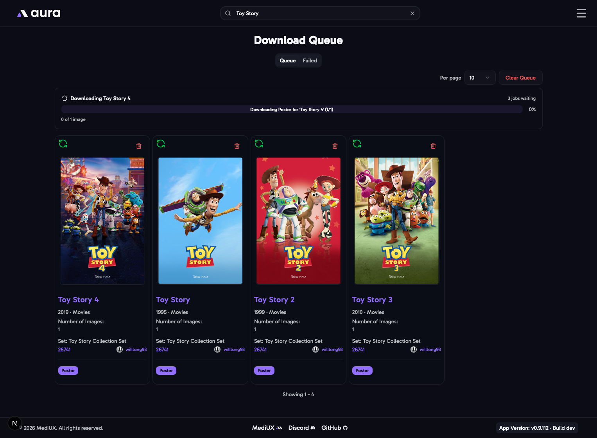
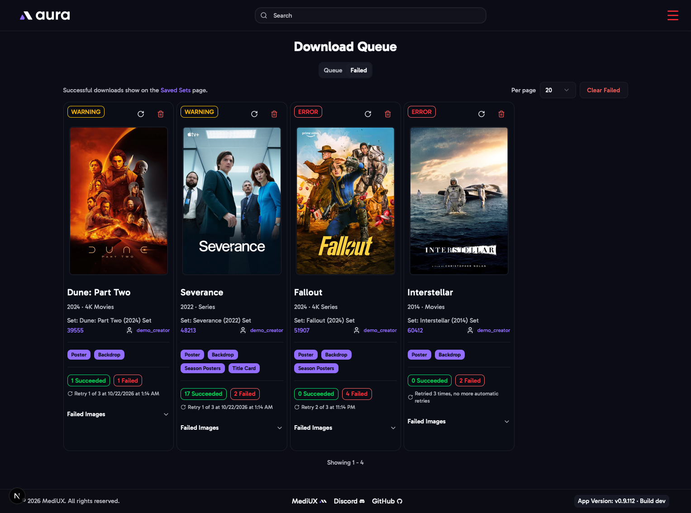

import { Aside } from "@astrojs/starlight/components";

The Download Queue runs downloads in the background, one set at a time, starting as soon as a set is added. Sets end up here when you use **Add to Queue** in the [download window](/AURA/how-to-use/downloading-sets/), and when aura downloads sets by itself, from your [favorite creators](/AURA/settings/user-preferences/#favorite-creators--automatic-downloads) or the Silo plugin.

## Queue

The sets waiting to download, and the one downloading now, with its progress. A collection's own poster and backdrop, queued from a [collection set](/AURA/how-to-use/downloading-sets/#collection-images), have their own entry, shown with the collection's name and poster. **Clear Queue** removes everything that's waiting. A download that has already started finishes.

## Failed

Sets that couldn't be downloaded, with the reason. When downloads have failed, the menu icon turns red and shows how many.

aura retries a failed download by itself, up to 3 times, waiting longer each time: 5 minutes, then 30 minutes, then 2 hours. Each entry shows when the next retry is, or that there are no more retries.

- **Retry** adds the set to the queue again straight away.
- **Delete** removes the entry.
- **Clear Failed** removes every failed entry.

<Aside>
  If a download keeps failing, look for it on the [Logs](/AURA/how-to-use/logs/) page, or attach a [Debug Bundle](/AURA/settings/advanced/#debug-bundle)
  when you ask for help.
</Aside>

Both tabs have paging, and remember how many entries you show per page.
