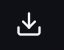
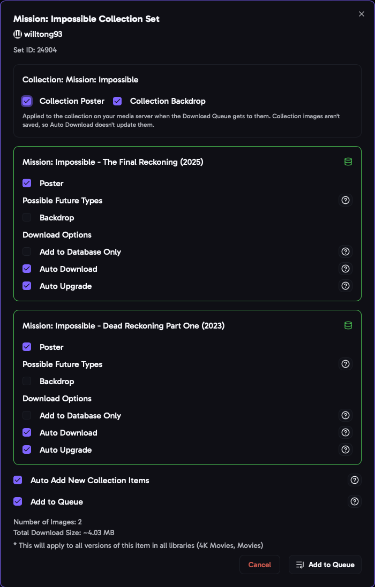
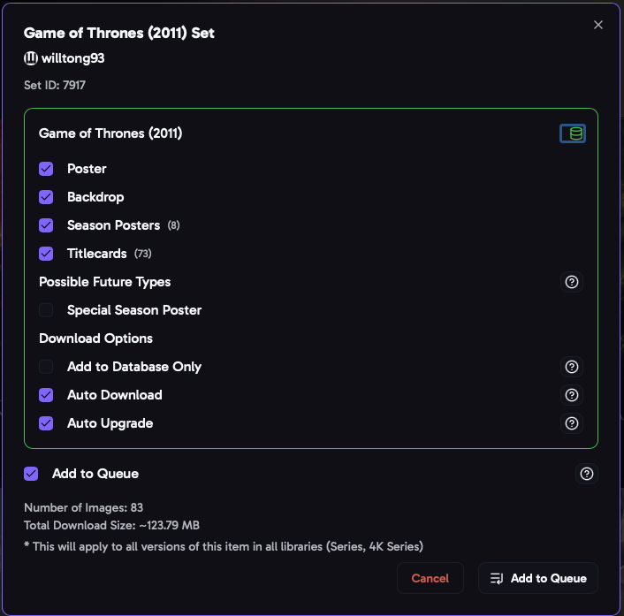

import { Aside } from "@astrojs/starlight/components";

Click the **download** button on any set to open the download window. You choose which images to apply, and aura saves the set so it can keep it up to date.

## Choosing Images

Each movie or show in the set has its own options. Click an image type to turn it on or off:

- **Movies and collections**: Poster and Backdrop.
- **Shows**: Poster, Backdrop, Season Posters, Special Season Poster (season 0) and Title Cards.

Your [download defaults](/AURA/settings/user-preferences/#download-defaults) are turned on to start with. The window shows how many images will be downloaded and their total size.

- **Already downloaded**: a type you've already downloaded from another saved set is marked, so you don't replace it by mistake. If the item is already saved, the window lists its other sets.
- **Possible future types**: a type the set doesn't have yet, like title cards for a new season, can still be selected. aura saves it, and [Auto Download](#auto-download) downloads it when the creator adds it.

## Download Options

### Auto Download

aura checks the set for new and updated images and downloads them, for example title cards for a new season. The **Auto Download** job runs every night by default; see [Jobs](/AURA/how-to-use/jobs/). On by default.

### Auto Upgrade

Lets aura replace this set with one from a higher ranked [favorite creator](/AURA/settings/user-preferences/#automatically-upgrade-sets), when **Automatically Upgrade Sets** is on. Turn it off to keep this set.

### Add to Database Only

Saves the set without downloading anything. Use it for sets you've already applied some other way, so aura knows about them and can keep them up to date.

### Auto Add New Collection Items (collection sets)

When a movie is added to the collection later, aura downloads its images from this set. Turn on [Auto Add New Collection Items by Default](/AURA/settings/user-preferences/#auto-add-new-collection-items-by-default) to have it checked to start with.

## Collection Images

A collection set on a movie's page can also have the collection's own poster and backdrop. If the collection is on your media server, the download window shows a row for it at the top, for example **Collection: Toy Story**, with **Collection Poster** and **Collection Backdrop**. They're checked to start with when they're in your [Download Defaults](/AURA/settings/user-preferences/#download-defaults).

- They're applied to the collection on your media server, after the movies. With **Add to Queue** on, they're added to the [Download Queue](/AURA/how-to-use/download-queue/) as their own entry, shown with the collection's name and poster.
- They aren't saved, so Auto Download doesn't update them.
- On a movie's page, the collection's images come first in the set, then the movie the page is for, then the rest of the collection, newest first.

### Add to Queue

Adds the set to the [Download Queue](/AURA/how-to-use/download-queue/) instead of downloading it while you wait. The queue downloads in the background, one set at a time, so you can close the window and queue up lots of sets quickly.

## Downloading

Click **Download**. The window shows each image's progress, and any that fail. Click **Retry** to try the failed ones again. When it's done, the set appears in [Saved Sets](/AURA/how-to-use/saved-sets/).

**Reset Form** puts the options back to how they were when the window opened.

<Aside>
  In a boxset, the same movie can be in both a movie set and a collection set. The download window asks which one to
  use, so the movie only gets one poster.
</Aside>
