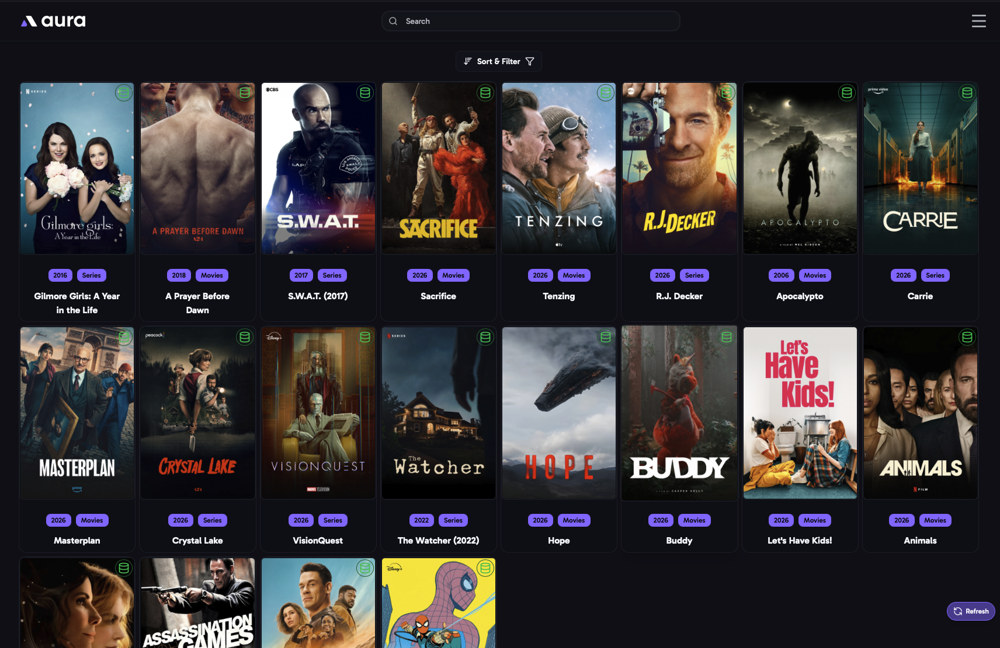

import { Aside } from "@astrojs/starlight/components";

The Home page shows the movies and shows in your main media server's libraries. Click one to open its [Media Item](/AURA/how-to-use/media-item/) page.

Each card shows the item's poster, title, year, library and edition. An icon in the corner shows its status:

- **Green database icon**: the item has a saved set.
- **Red eye**: always ignored.
- **Orange eye**: ignored until a set is available.
- **Yellow eye**: ignored until a new set is available.

## Sort & Filter

Open **Sort & Filter** to change what's shown. Your choices are remembered, and are the same on every device.

### Sort

- **Date Added**: when the item was added to your library.
- **Date Updated**: when the item was last updated on your media server, if your media server reports it.
- **New Episode Added**: shows with the newest episodes first. Only shown when it's turned on in [Media Servers](/AURA/settings/media-servers/#enable-sort-by-episode-added-date-plex-only).
- **Date Released**
- **Title**

Click the arrow to switch between ascending and descending.

### Filters

- **Library Sections**: which libraries to show.
- **In-Database Filter**: only items **in the database** (with a saved set), or only items **not in the database**.
- **Ignored Filter**: only ignored items, by how they're ignored, or only items that aren't ignored. See [Ignoring Items](/AURA/how-to-use/media-item/#ignoring-items).
- **Has Sets Available Filter**: only items that have, or don't have, sets on MediUX.

**Reset to Defaults** puts the sort and filters back to how they started.

## Paging

Choose how many items to show per page, and move between pages with the page buttons.

<Aside>
  New items appear on their own: the **Check for New Media Items** job adds them every 10 minutes. To reload
  everything from your media server, run the **Refresh Media Items and Collections** job on the [Jobs](/AURA/how-to-use/jobs/) page.
</Aside>
