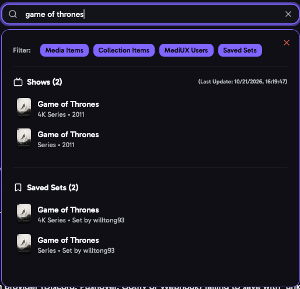

import { Aside, CardGrid, LinkCard } from "@astrojs/starlight/components";

aura lets you browse your media server's libraries, find image sets for them on MediUX, and apply the ones you like. Sets you save are kept up to date automatically.

## The Basics

1. Find a movie or show on the [Home](/AURA/how-to-use/home/) page, or with the search bar.
2. Its [Media Item](/AURA/how-to-use/media-item/) page lists every MediUX set for it.
3. Click the download button on a set to [apply its images](/AURA/how-to-use/downloading-sets/).
4. The set is saved in [Saved Sets](/AURA/how-to-use/saved-sets/), and aura downloads new images as the creator adds them.

## The Menu

The menu (top right) opens every page: **Saved Sets**, **Collections**, **Download Queue**, **Settings**, **Logs** and **Jobs**. Click the aura logo to go back Home.

When a download has failed, the menu icon turns red and the Download Queue shows how many failed.

## Search

The search bar at the top searches as you type. Results are grouped, and the filter buttons under the search bar choose which groups to show:

- **Media Items**: movies and shows in your libraries.
- **Collection Items**: movie collections on your media server.
- **MediUX Users**: creators on MediUX. Click one to open their [creator page](/AURA/how-to-use/creator/).
- **Saved Sets**: your saved sets. Off by default.

You can narrow down a search by adding these to it:

| Add          | To find                       | Example                  |
| ------------ | ----------------------------- | ------------------------ |
| `Y:<year>:`  | Items from that year          | `alien Y:1979:`          |
| `L:<name>:`  | Items in that library         | `alien L:4K Movies:`     |
| `ID:<id>:`   | The item with that ID         | `ID:12345:`              |

<Aside>
  On the Home, Saved Sets, Collections and creator pages, what you type also filters the page you're on.
</Aside>

## Pages

<CardGrid>
  <LinkCard title="Home" description="Browse your libraries." href="/AURA/how-to-use/home/" />
  <LinkCard title="Media Item" description="A movie or show, and every set for it." href="/AURA/how-to-use/media-item/" />
  <LinkCard title="Downloading Sets" description="Choose and apply images from a set." href="/AURA/how-to-use/downloading-sets/" />
  <LinkCard title="Set" description="Every image in one set." href="/AURA/how-to-use/set/" />
  <LinkCard title="Creator" description="Every set by one MediUX creator." href="/AURA/how-to-use/creator/" />
  <LinkCard title="Collections" description="Your movie collections and their images." href="/AURA/how-to-use/collections/" />
  <LinkCard title="Saved Sets" description="The sets you've saved, and keeping them up to date." href="/AURA/how-to-use/saved-sets/" />
  <LinkCard title="Download Queue" description="Downloads waiting to run, and failed downloads." href="/AURA/how-to-use/download-queue/" />
  <LinkCard title="Jobs" description="The background jobs, and when they run." href="/AURA/how-to-use/jobs/" />
  <LinkCard title="Logs" description="What aura has been doing, and finding problems." href="/AURA/how-to-use/logs/" />
  <LinkCard title="Change Log" description="What's new, and your build details." href="/AURA/how-to-use/change-log/" />
</CardGrid>
