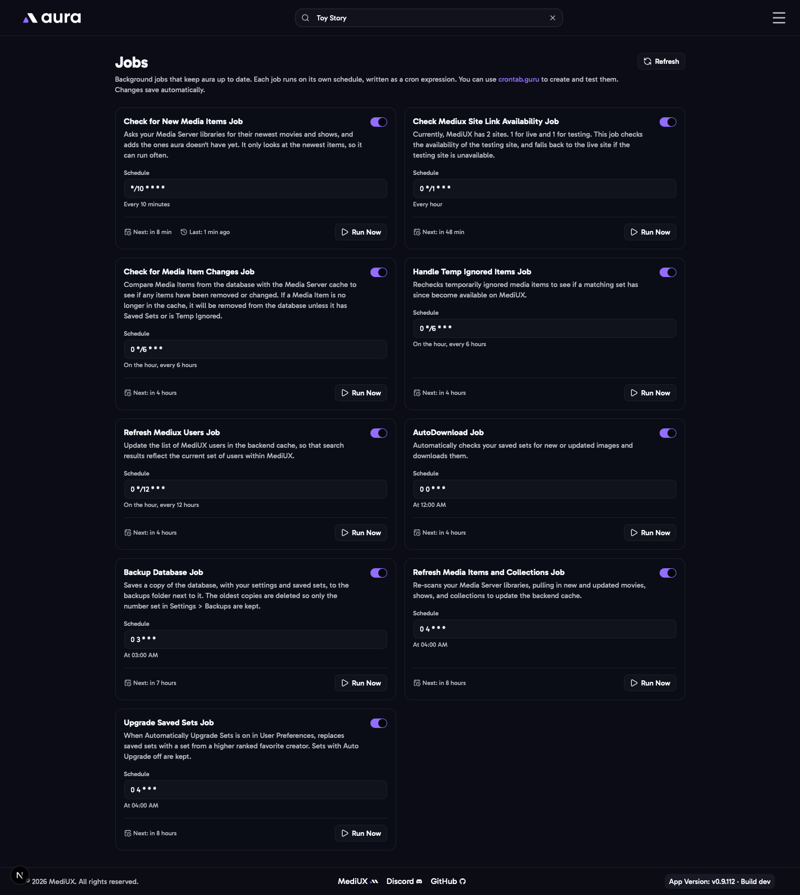

import { Aside } from "@astrojs/starlight/components";



aura runs jobs in the background to keep your libraries, saved sets and backups up to date. The **Jobs** page lists them, sorted by when they run next.

For each job you can:

- **Turn it on or off.** A job that's off doesn't run on its schedule, but you can still run it yourself.
- **Change its schedule**, as a cron expression. Use [crontab.guru](https://crontab.guru/) to build one. Times use your `TZ` time zone.
- **Run it now** with the play button.

Each job shows when it ran last and when it runs next. Changes save automatically.

## The Jobs

| Job                                   | Default schedule          | What it does                                                                                                                         |
| ------------------------------------- | ------------------------- | ------------------------------------------------------------------------------------------------------------------------------------ |
| **Auto Download**                     | Every day at midnight     | Checks your saved sets with Auto Download on for new and updated images, and downloads them.                                         |
| **Check for New Media Items**         | Every 10 minutes          | Asks your media server for its newest movies and shows, and adds the ones aura doesn't have yet. It only looks at the newest items, so it can run often. With [Automatically Download Images for New Items](/AURA/settings/user-preferences/#automatically-download-images-for-new-items) on, it also queues a set for each new item. |
| **Refresh Media Items and Collections** | Every day at 4:00 AM    | Reloads everything from your media server libraries: new, changed and removed movies, shows and collections.                         |
| **Check for Media Item Changes**      | Every 6 hours             | Compares your saved items with your media server, to find items that changed or were removed. Items that are gone are removed from the database, unless they have saved sets or are ignored. |
| **Handle Temp Ignored Items**         | Every 6 hours             | Checks whether items you [ignored until a set is available](/AURA/how-to-use/media-item/#ignoring-items) now have one.               |
| **Upgrade Saved Sets**                | Every day at 4:00 AM      | When [Automatically Upgrade Sets](/AURA/settings/user-preferences/#automatically-upgrade-sets) is on, replaces saved sets with sets from higher ranked favorite creators. |
| **Backup Database**                   | Every day at 3:00 AM      | Backs up the database. See [Backups](/AURA/settings/backups/).                                                                        |
| **Refresh MediUX Users**              | Every 12 hours            | Updates the list of MediUX creators used by search.                                                                                  |
| **Check MediUX Site Link**            | Every hour                | MediUX has a live site and a testing site. This checks whether the testing site is up, and uses the live site if it isn't.           |

<Aside>
  The Download Queue isn't listed here. It runs all the time, and starts each download as soon as it's added.
</Aside>

## In the Config File

```yaml
Jobs:
  AutoDownload:
    Enabled: true
    Cron: "0 0 * * *"
  CheckForNewMediaItems:
    Enabled: true
    Cron: "*/10 * * * *"
  RefreshMediaItemsAndCollections:
    Enabled: true
    Cron: "0 4 * * *"
  CheckForMediaItemChanges:
    Enabled: true
    Cron: "0 */6 * * *"
  HandleTempIgnoredItems:
    Enabled: true
    Cron: "0 */6 * * *"
  UpgradeSavedSets:
    Enabled: true
    Cron: "0 4 * * *"
  BackupDatabase:
    Enabled: true
    Cron: "0 3 * * *"
  RefreshMediuxUsers:
    Enabled: true
    Cron: "0 */12 * * *"
  CheckMediuxSiteLink:
    Enabled: true
    Cron: "0 */1 * * *"
```

Jobs you leave out use their defaults, so you only need to list the ones you change.
