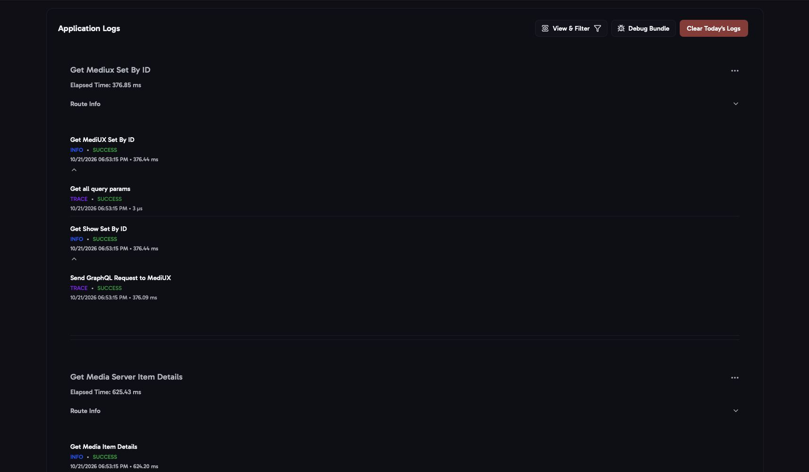

import { Aside } from "@astrojs/starlight/components";

The **Logs** page shows what aura has done, newest first: every page you opened, download, job and setting change. Click an entry to see each step, with its results, warnings and errors.

How much is logged depends on the level in [Logging](/AURA/settings/logging/).

## Filters

- **Levels**: TRACE, DEBUG, INFO, WARNING and ERROR.
- **Status**: only entries that succeeded, or that had warnings or errors.
- **Actions**: only one kind of action, for example the Auto Download job or saving a set.

**Clear All Filters** shows everything again.

## Actions

- **Debug Bundle** downloads a zip with your versions, redacted settings and redacted logs, to attach when you report a problem. See [Debug Bundle](/AURA/settings/advanced/#debug-bundle).
- **Export Log**, in an entry's menu, saves that one entry as a JSON file.
- **Clear Today's Logs** deletes today's log file.

<Aside title="Reporting a problem">
  1. Set the log level to **TRACE** in [Logging](/AURA/settings/logging/).
  2. Clear the log file. 
  3. Do whatever didn't work again.
  4. Download the **Debug Bundle** and attach it to your bug report on [GitHub](https://github.com/mediux-team/aura/issues) or [Discord](https://discord.gg/YAKzwKPwyw).
</Aside>
