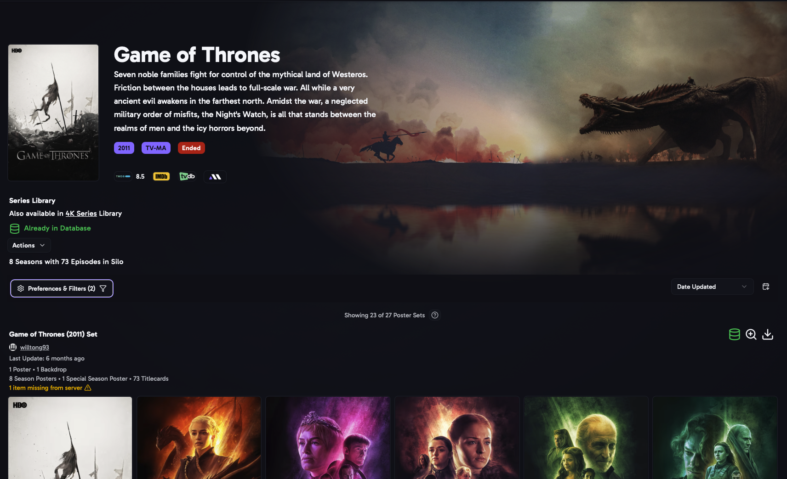
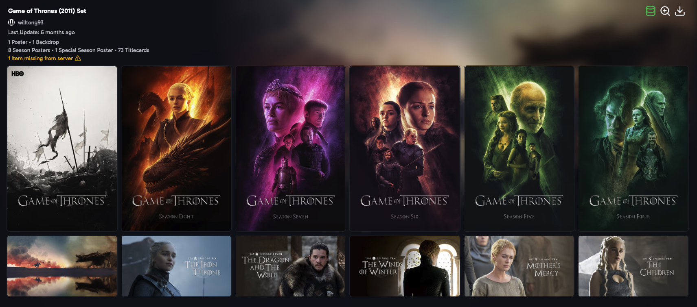

import { Aside } from "@astrojs/starlight/components";

A movie or show's page has its details at the top, and every MediUX set for it below.

## Details

- The poster, backdrop, title, year, ratings and summary.
- **Movie Details**: the file path, file size and duration. For a show, how many seasons and episodes your media server has.
- Other libraries that have the same movie or show. Click a library to open the item there.
- If the item has saved sets, a link to it in [Saved Sets](/AURA/how-to-use/saved-sets/).

## Actions

The **Actions** menu has:

- **Refresh Metadata**: asks your media server to refresh the item's metadata. For a show, choose which seasons to refresh.
- **Manual YAML Import**: paste a set's YAML from MediUX to apply its images. **Validate YAML** checks it before you import.
- **View Current Images**: shows the images on your media server right now.
- **View in Saved Sets**: opens the item in [Saved Sets](/AURA/how-to-use/saved-sets/).
- **Ignore** options, see [Ignoring Items](#ignoring-items).

On Plex and Silo, you can also **rate** the item. The rating is set on your media server.

## Sets

Every MediUX set for the item is listed, with its images in a carousel. Sets by creators you follow come first.

- Click the set's name, or the magnifying glass, to open the [Set](/AURA/how-to-use/set/) page.
- Click the creator's name to open their [creator page](/AURA/how-to-use/creator/).
- Dimmed images are for items that aren't in your library, including a collection's own poster and backdrop when the collection isn't on your media server.
- Click the **download** button to [apply the set's images](/AURA/how-to-use/downloading-sets/). You can mix and match: apply the poster from one set and the title cards from another.

Movies can also have **collection sets**, which cover every movie in a collection. They're listed with the movie's sets.

<Aside>
	Want to quickly download a single image, double-click the image then
	download. These downloads are applied automatically and not saved to the
	database. It is helpful if you want to fix something that the media server
	changed.
</Aside>

### Sort

- **Date Updated**: the most recently updated sets first.
- **User Name**: by creator.
- **Popularity**: the most popular sets on MediUX first.
- **Number in Collection** (movies): collection sets with the most movies first.
- **Number of Seasons** and **Number of Titlecards** (shows): the most complete sets first.

### Preferences & Filters

- **Download Defaults**, **Only Show Selected Image Types**, **Add to Queue by Default** and **Add to Database Only by Default**: the same as in [User Preferences](/AURA/settings/user-preferences/). Changing them here changes them everywhere.
- **Show Hidden Users**: also show sets from creators you've hidden on MediUX.
- **Only Show Sets with Titlecards** (shows).
- **Show Date Modified**: show when each image was last changed on MediUX.
- **Languages**: only show sets with images in these languages.

## Ignoring Items

Ignore an item you don't want to find sets for, so it stops showing up in the **Has Sets Available** and **Not in Database** filters. There are three ways to ignore it:

| Option                                | What happens                                                                                                    |
| ------------------------------------- | --------------------------------------------------------------------------------------------------------------- |
| **Always Ignore**                     | The item stays ignored until you remove it.                                                                     |
| **Ignore Until Set is Available**     | For items with no sets yet. When a set appears on MediUX, the item is no longer ignored and you're notified.    |
| **Ignore Until New Set is Available** | For items whose sets you don't like. When a new set appears, the item is no longer ignored and you're notified. |

The **Handle Temp Ignored Items** job checks for new sets every 6 hours. **Remove Ignore Status** stops ignoring the item.

<Aside>
	The notification is the **New Sets Available for Ignored Item** notification
	in [Notifications](/AURA/settings/notifications/).
</Aside>
