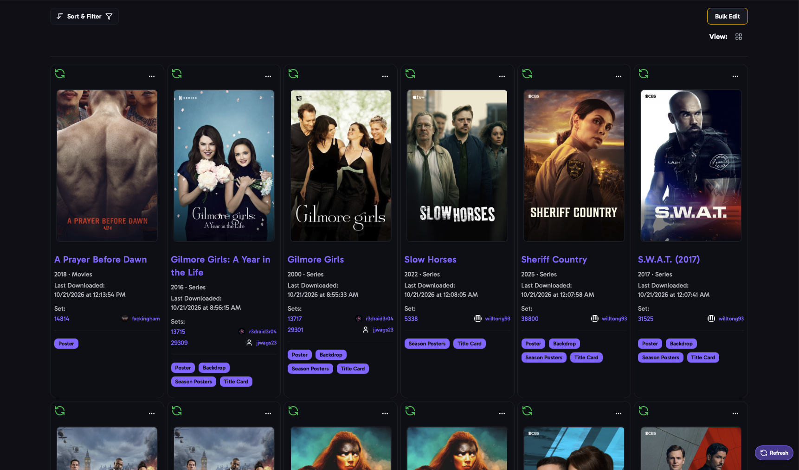
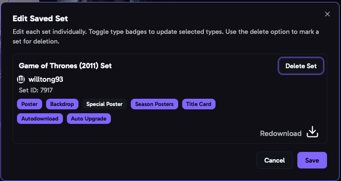

import { Aside } from "@astrojs/starlight/components";

Every set you download is saved here. aura uses your saved sets to keep your images up to date: the **Auto Download** job checks them for new and updated images, and the **Sonarr webhook** and **Plex websocket listener** use them to apply images again.

Each movie or show can have more than one saved set, for example the poster from one set and the title cards from another.

## Views

Switch between **Card View** and **Table View**. The table shows each item's title, year, library, when it was last downloaded, its sets and their image types.

Note: Table View is only present on Desktop screens.

## Sort & Filter

- **Sort** by **Date Downloaded**, **Title**, **Year** or **Library**.
- **Library**: which libraries to show.
- **Selected Types**: only sets with these image types, or with **No Selected Types**.
- **AutoDownload**: only sets with Auto Download on, or off.
- **Multi Set Only**: only items with more than one saved set.
- **Media Item on Server**: only items that are, or aren't, still on your media server.
- **Users**: only sets by these creators.

## Editing a Set

Open an item's menu and choose **Edit** to change its sets. For each set you can:

- Turn image types on or off.
- Turn **Auto Download** and **Auto Upgrade** on or off.
- **Redownload** the set, to apply its images again. **Set has updates** shows when the creator has changed the set since you last downloaded it.
- **Delete** the set. Its images stay on your media server.

## Bulk Actions

Select items with their checkboxes, or **Select All**, then choose an action:

| Action                           | What it does                                                                                                                 |
| -------------------------------- | ---------------------------------------------------------------------------------------------------------------------------- |
| **Force Autodownload Recheck**   | Checks the sets for new and updated images now, instead of waiting for the Auto Download job.                                |
| **Enable Autodownload**          | Turns Auto Download on.                                                                                                      |
| **Disable Autodownload**         | Turns Auto Download off.                                                                                                     |
| **Force Redownload**             | Downloads and applies every image in the sets again.                                                                         |
| **Upgrade to Favorite Creators** | Replaces sets with sets from higher ranked [favorite creators](/AURA/settings/user-preferences/#automatically-upgrade-sets). |
| **Apply Labels/Tags**            | Applies your [labels and tags](/AURA/settings/labels-and-tags/) to the items again.                                          |
| **Delete Selected Sets**         | Deletes the sets. Their images stay on your media server.                                                                    |

After a recheck, **Recheck Status** shows the result for each item.

<Aside>
	Saved sets for items that are no longer on your media server are kept, and
	marked as not on the server. Use the **Media Item on Server** filter to find
	them.
</Aside>
