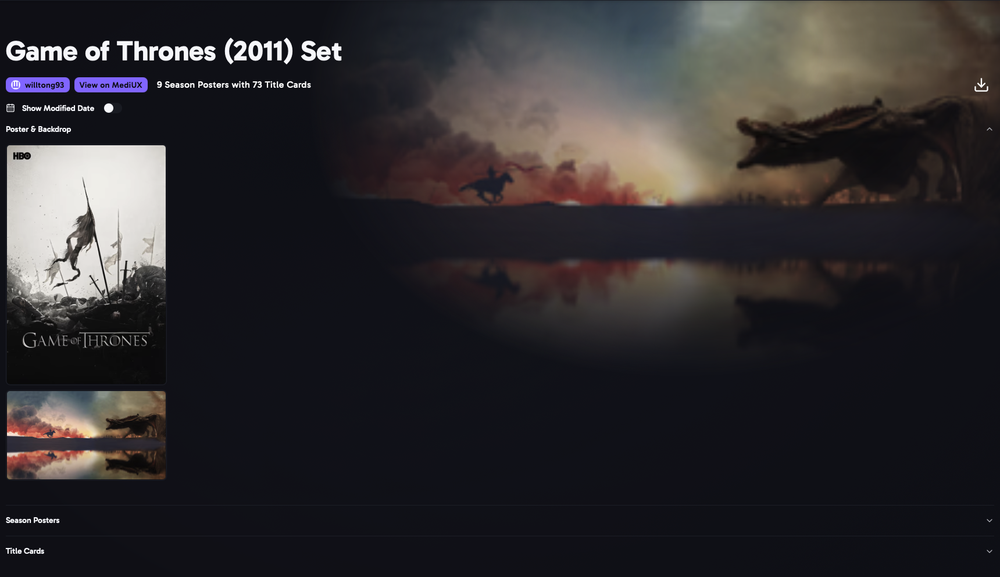

The Set page shows every image in a set. Open it by clicking a set's name, or the magnifying glass, on a [Media Item](/AURA/how-to-use/media-item/) or [creator](/AURA/how-to-use/creator/) page.

- Show sets list the poster and backdrop, then **Season Posters**, then every **Title Card**, grouped by season.
- Click the creator's name to open their [creator page](/AURA/how-to-use/creator/).
- **View on MediUX** opens the set on MediUX.
- **Show Modified Date** shows when each image was last changed on MediUX.
- The **download** button opens the [download window](/AURA/how-to-use/downloading-sets/) for the whole set.
