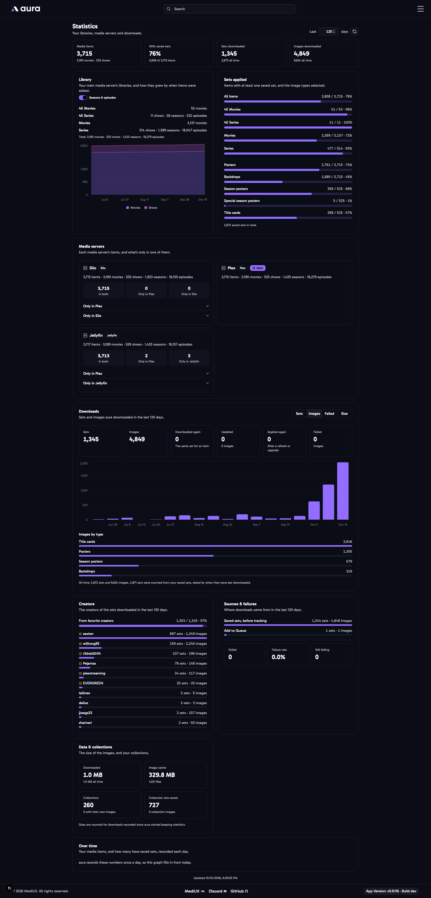

import { Aside } from "@astrojs/starlight/components";

The **Statistics** page shows your libraries, your media servers, your saved sets and aura's downloads, with graphs of how they change. Open it from the menu.

Type how many days back the graphs go at the top, 1 or more. It's 30 to start with, and leaving the box empty puts it back to 30. Each point is a day for up to 45 days, a week for up to about a year, and a month for longer. The page remembers the number on every device.

## Library

Each library of your main media server, with its movies or shows. Turn on **Seasons & episodes** to count those for your show libraries too. The graph shows how your libraries grew, by when each item was added to your media server.

<Aside>
	Silo counts its episodes for each library, and the seasons from each show's
	details, which aura refreshes once a week.
</Aside>

## Sets Applied

How many items have at least one saved set, for each library, and how many have each image type selected: posters, backdrops, season posters, special season posters and title cards. Title cards and season posters only count shows.

## Media Servers

Each media server's items, side by side. For each other media server, its items are matched to the main media server's by TMDB ID, through its [library map](/AURA/settings/media-servers/#library-mapping):

- **In both**: on both media servers.
- **Only in** the main media server, or **only in** the other one. Open them to see the items.

Libraries that don't match a main media server library aren't compared, and are listed under the media server.

## Downloads

The sets and images aura downloaded in the range, from the download window, the [Download Queue](/AURA/how-to-use/download-queue/), Auto Download, favorite creators and upgrades:

- **Sets** and **Images** downloaded.
- **Downloaded again**: a set downloaded again for the same item, like a redownload or an upgrade to it.
- **Updated**: sets [Auto Download](/AURA/how-to-use/downloading-sets/#auto-download) downloaded new or changed images for.
- **Applied again**: saved images applied again after a Plex refresh, or title cards after a Sonarr upgrade.
- **Failed**: images that couldn't be downloaded.

The graph shows the sets, images, failed images or size for each day, week or month. Under it are the images downloaded of each type.

<Aside>
	aura started counting downloads in version v0.9.117. Your saved sets were
	counted as one download each, dated by when they were last downloaded, so
	the graph before then is an estimate.
</Aside>

## Creators

The creators of the sets you downloaded in the range, with the most first, and how many sets came from your [favorite creators](/AURA/settings/user-preferences/#favorite-creators--automatic-downloads). Favorite creators have a crown. Click a creator to open their page.

## Sources & Failures

Where downloads came from: the download window, Add to Queue, favorite creators, upgrades, the Silo plugin, Auto Download, the Sonarr webhook or a Plex refresh. Below are the images that failed in the range, the failure rate, how many downloads are still failing in the Download Queue, and the most common reasons.

## Data & Collections

The size of the images downloaded, the size of the MediUX image cache on disk, how many collections your media server has, how many aura applied their own images to, and the collection sets you've saved.

## Over Time

Your media items, and how many have saved sets, recorded once a day.
