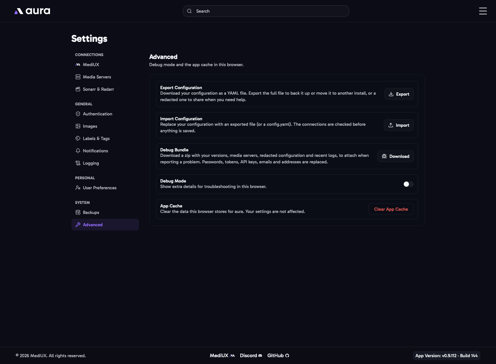

import { Aside } from "@astrojs/starlight/components";

## Export Configuration

Downloads your configuration as a YAML file, in the [config file](/AURA/config/) format. You choose which kind:

- **Full**: everything, including your passwords, tokens and API keys. Use it to back up your settings or move them to another install. Keep it private.
- **Redacted**: passwords, tokens, API keys, emails and addresses are replaced, so it's safe to share when you ask for help. Each address becomes `host-1`, `host-2` and so on. A redacted file can't be imported.

## Import Configuration

Replaces your configuration with an exported file, or a `config.yaml`. aura checks it first, including the media server and MediUX connections, and nothing is saved unless it's valid. Your API key isn't changed by an import.

## Debug Bundle

Downloads a zip to attach when you report a problem. It has:

- `info.txt`: your aura, database and platform versions, and each media server's type, version and libraries.
- `config-redacted.yaml`: your configuration, redacted the same way as a redacted export.
- `logs/`: your recent log files, with the same passwords, tokens, emails and addresses replaced.

The same download is on the [Logs](/AURA/how-to-use/logs/) page.

<Aside>
  The bundle is redacted, but have a quick look through it before you share it publicly.
</Aside>

## Debug Mode

Shows extra details for troubleshooting in this browser, and logs more to the browser's developer console. It only affects the browser you turn it on in.

## App Cache

**Clear App Cache** clears the data this browser stores for aura, such as cached pages and your last search. Your settings aren't affected. Try it if a page shows old information or doesn't load.
