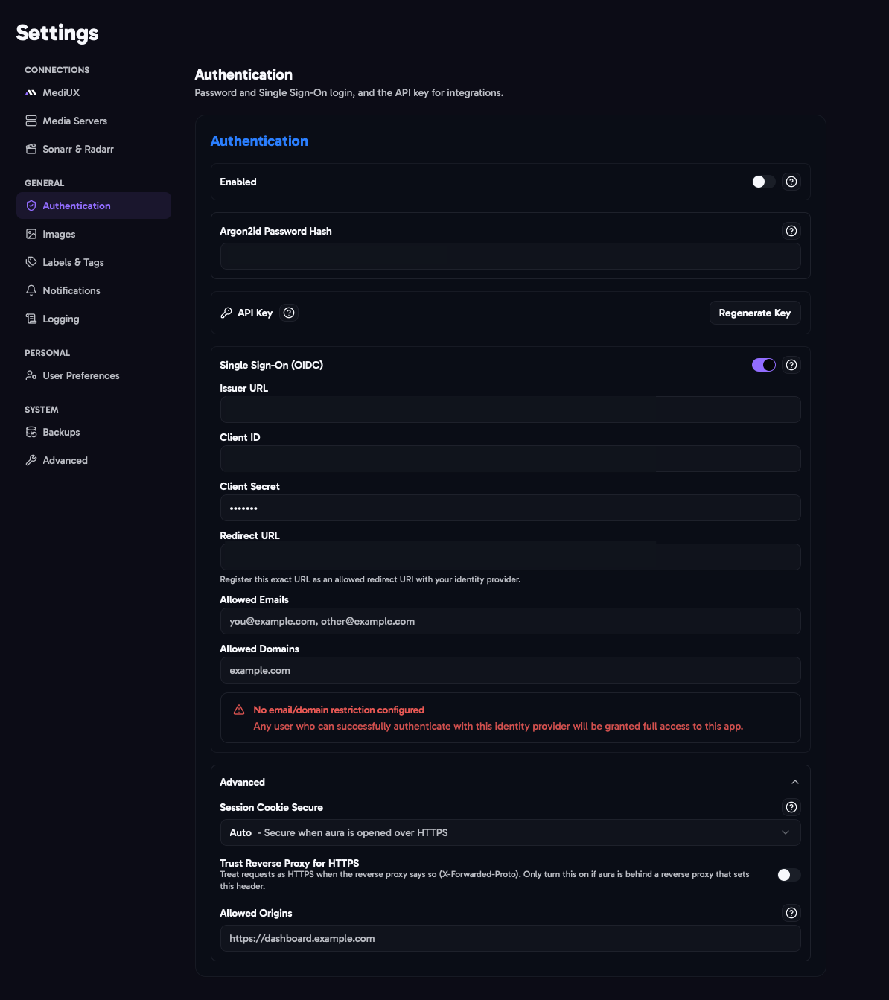
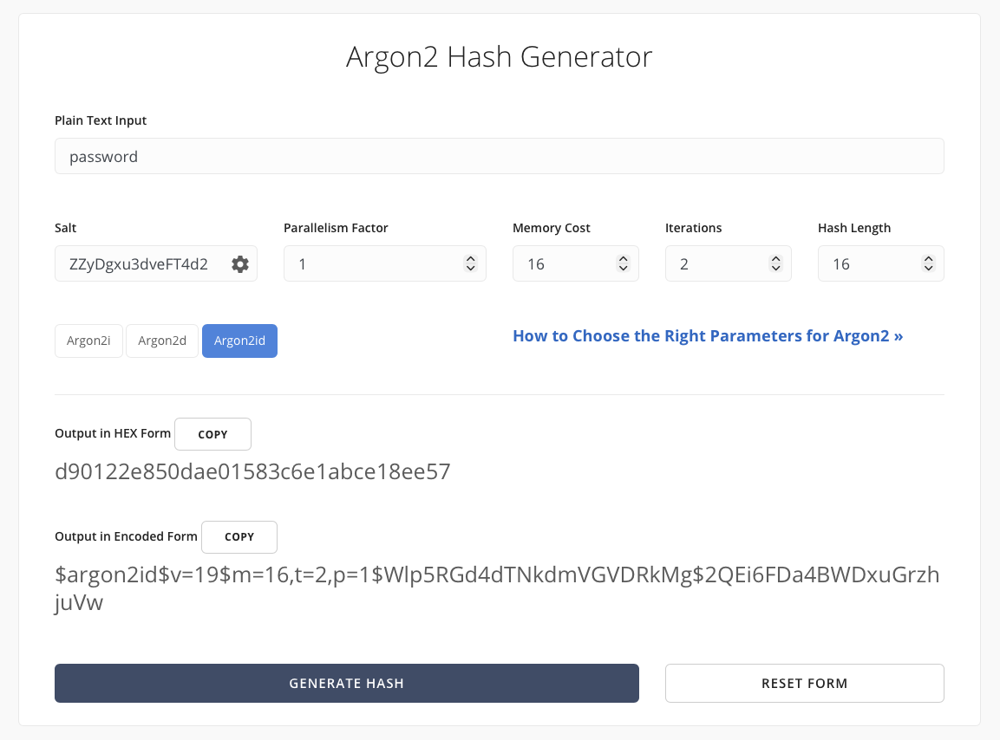

import { Aside } from "@astrojs/starlight/components";



aura has two ways to log in from a browser, a **password** and **Single Sign-On (OIDC)**, and an **API key** for scripts and integrations like the Sonarr webhook.

## Enabled

Turn on to require a login before anyone can use aura. You need to set a password (below) first.

<Aside type="caution">
  If aura can be reached from outside your home network, turn authentication on. For extra protection, put aura behind
  an authentication proxy like [Authentik](https://goauthentik.io/), [Authelia](https://www.authelia.com/) or
  [Tinyauth](https://tinyauth.app/), or use the built-in Single Sign-On.
</Aside>

## Argon2id Password Hash

aura doesn't store your password, only an **Argon2id hash** of it. To create one:

1. Open [Argon2.Online](https://argon2.online/) (also linked next to the field).
2. Type your password, keep the default settings, and generate the hash.
3. Paste the result, which starts with `$argon2id$`, into the field.



Logging in sets a session cookie in your browser.

## API Key

A key for scripts and other apps, such as the [Sonarr webhook](/AURA/sonarr-webhook-integration/). Send it in the `X-Api-Key` header. The [API docs](/AURA/config/#api-docs) let you try the API with your key.

- Click **Generate Key** to create a key. **Copy it straight away**, it's only shown once. aura only stores a hash of it.
- If you lose it, click **Regenerate Key**. The old key stops working everywhere straight away.

## Single Sign-On (OIDC)

Log in through your own identity provider, such as Authelia, Authentik, Pocket ID or Keycloak. It works alongside the password, not instead of it.

- **Issuer URL**: the base URL of your identity provider, for example `https://idp.example.com`. If you paste the `/.well-known/openid-configuration` address instead, aura removes that part for you.
- **Client ID** and **Client Secret**: from the client you create for aura in your identity provider.
- **Redirect URL**: your aura address followed by `/api/auth/oidc/callback`, for example `https://aura.example.com/api/auth/oidc/callback`. Register this exact URL with your identity provider. If it points anywhere else, Single Sign-On stays unavailable and saving shows why.
- **Allowed Emails** and **Allowed Domains**: who may log in. Separate entries with commas.

<Aside type="danger" title="Set an allowlist">
  If both Allowed Emails and Allowed Domains are empty, **anyone** who can log in to your identity provider gets full
  access to aura. aura has no separate user accounts, so this is the same as giving them the password. Settings shows a
  warning while no allowlist is set.
</Aside>

## Advanced

These are only needed in unusual setups. Leave them at their defaults unless logging in doesn't work.

### Session Cookie Secure

Whether the login cookie is marked **Secure**, so the browser only sends it over HTTPS.

- **Auto** (default, recommended): Secure when you open aura over HTTPS, and not over plain HTTP. This is what most home setups, such as `http://192.168.1.50:3000`, need.
- **Always**: always Secure. Logging in over plain HTTP will silently fail.
- **Never**: never Secure.

### Trust Reverse Proxy for HTTPS

Treats requests as HTTPS when a reverse proxy says so with the `X-Forwarded-Proto` header. Turn this on if aura is behind a reverse proxy like Nginx or Traefik that handles HTTPS, and logging in doesn't stick. Only turn it on if your proxy always sets this header, as otherwise it can be faked.

### Allowed Origins

Other websites allowed to call the aura API with your login, for example a dashboard on another domain. It's not needed when you use aura normally.

## Locked Out?

If you forget your password or your identity provider breaks, set the `AURA_DISABLE_AUTH=true` environment variable and restart aura. Log in, fix your authentication settings, then remove the variable and restart aura again. While it's set, anyone who can reach aura can use it.

## In the Config File

```yaml
Auth:
  Enabled: true
  Password: YOUR_ARGON2ID_HASH
  SessionCookieSecure: auto # auto, always or never
  TrustProxyForCookieSecure: false
  AllowedOrigins: []
  OIDC:
    Enabled: true
    IssuerURL: https://idp.example.com
    ClientID: aura
    ClientSecret: YOUR_OIDC_CLIENT_SECRET
    RedirectURL: https://aura.example.com/api/auth/oidc/callback
    AllowedEmails:
      - you@example.com
    AllowedDomains:
      - example.com
```

The API key isn't set in the config file. Generate it in Settings. Importing a config file doesn't change it.
