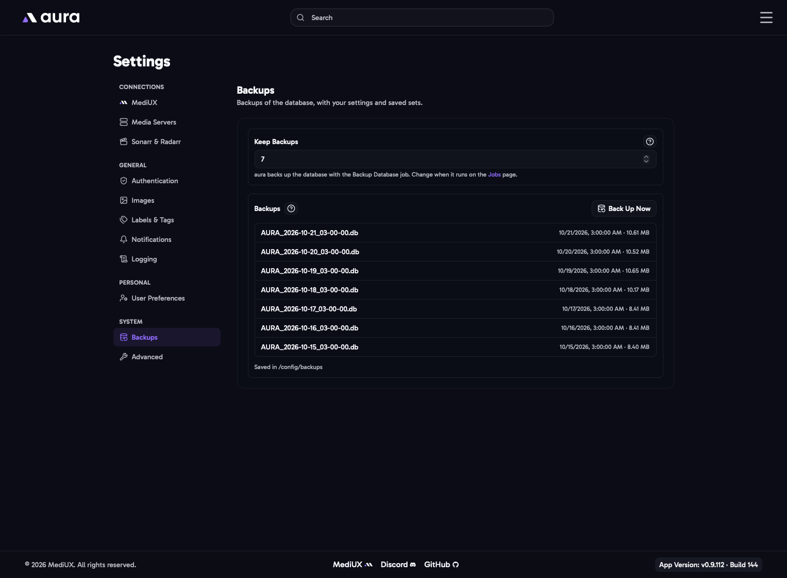

import { Aside, Steps } from "@astrojs/starlight/components";



aura backs up its database every day with the **Backup Database** job (at 3:00 AM by default, see [Jobs](/AURA/how-to-use/jobs/)). Each backup is a complete copy of the database, with your settings, saved sets and download history.

## Keep Backups

How many backups are kept, from 1 to 100 (default 7). The oldest is deleted when a new backup is made.

## Backups

Lists your backups, newest first. **Back Up Now** makes a backup straight away, for example before you try something new.

Backups are saved in a `backups` folder next to the database, `/config/backups` by default, as `AURA_<date>_<time>.db`.

aura also makes a backup before each database update, next to `AURA.db` in `/config`, named like `AURA_backup_v7_to_v8_<timestamp>.db`. These aren't listed here or deleted automatically, so you can remove old ones yourself once you're happy with the update.

## Restoring a Backup

<Steps>

1. Stop aura.
2. Move `AURA.db` out of the `/config` folder, along with `AURA.db-wal` and `AURA.db-shm` if they're there.
3. Copy the backup into the `/config` folder and rename it to `AURA.db`.
4. Start aura.

</Steps>

<Aside>
  Restoring a backup also restores the settings saved in it. If you changed settings after the backup, export them
  first from [Advanced](/AURA/settings/advanced/) so you can import them again.
</Aside>

## In the Config File

```yaml
Backups:
  Keep: 7
```
