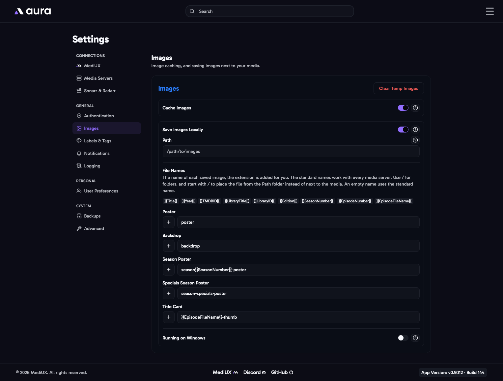

import { Aside } from "@astrojs/starlight/components";



## Cache Images

Keeps a copy of the MediUX images aura shows and downloads in the `temp-images` folder inside `/config`. Images you've already seen load straight from the cache instead of from MediUX, which is faster and puts less load on MediUX. The cache takes up disk space, so it's off by default.

**Clear Temp Images** deletes everything in the cache. aura downloads images again as you need them.

## Save Images Locally

Every image aura applies is always applied on your media server. With **Save Images Locally** on, aura also saves a copy as a file, by default next to your movie or show. If your media server's database is ever lost or rebuilt, it picks up the saved images again, and other apps that read these files can use them too.

- It works the same for Plex, Emby, Jellyfin and Silo.
- aura must be able to reach your media folders at **the same paths as your media server**. See [The Volumes](/AURA/installation/docker-compose/#the-volumes).
- Only the main media server's images are saved.
- Silo only reads these files when it first scans an item, so for Silo the saved copy doesn't change what Silo shows.

### Path

Leave this empty to save images next to your media, which is what media servers expect.

Set a folder to save every image there instead, for example for another app that reads images from its own folder. Make sure the folder is mapped into the aura container and aura can write to it.

### File Names

The file name of each image type, without the extension, which aura adds for you. The standard names work with every media server, so most people never need to change them.

| Image                 | Standard name                   | Saved as, for example                     |
| --------------------- | ------------------------------- | ----------------------------------------- |
| Poster                | `poster`                        | `Alien (1979)/poster.jpg`                 |
| Backdrop              | `backdrop`                      | `Alien (1979)/backdrop.jpg`               |
| Season Poster         | `season{{SeasonNumber}}-poster` | `Severance/season01-poster.jpg`           |
| Special Season Poster | `season-specials-poster`        | `Severance/season-specials-poster.jpg`    |
| Title Card            | `{{EpisodeFileName}}-thumb`     | `Severance/Season 01/Severance - S01E01-thumb.jpg` |

Use the **+** button next to a field to add a variable:

| Variable              | Value                                                   |
| --------------------- | ------------------------------------------------------- |
| `{{Title}}`           | The movie or show title                                 |
| `{{Year}}`            | The release year                                        |
| `{{TMDBID}}`          | The TMDB ID                                             |
| `{{LibraryTitle}}`    | The library's name on the media server                  |
| `{{LibraryID}}`       | The library's ID on the media server                    |
| `{{Edition}}`         | The movie's edition, for example `Director's Cut`       |
| `{{SeasonNumber}}`    | The season number, two digits                           |
| `{{EpisodeNumber}}`   | The episode number, two digits                          |
| `{{EpisodeFileName}}` | The episode's file name, without its extension          |

- Use `/` to save into folders.
- A name that starts with `/` is placed in the **Path** folder instead of next to the media.
- An empty name, or one with an unknown variable or `..`, uses the standard name.

For example, to save posters for Agregarr's base posters, set **Path** to Agregarr's folder and the poster name to:

```txt
/{{LibraryTitle}}-{{LibraryID}}/{{Title}} ({{Year}}) tmdb-{{TMDBID}}/poster
```

### Running on Windows

Turn this on if your **media server** runs on Windows. Windows paths from the media server, such as `C:\Movies`, are then turned into paths aura can use, such as `/C/Movies`. Map that path into the aura container.

## In the Config File

```yaml
Images:
  CacheImages:
    Enabled: false
  SaveImagesLocally:
    Enabled: false
    Path: ""
    RunningOnWindows: false
    NameTemplates:
      Poster: "poster"
      Backdrop: "backdrop"
      SeasonPoster: "season{{SeasonNumber}}-poster"
      SpecialSeasonPoster: "season-specials-poster"
      Titlecard: "{{EpisodeFileName}}-thumb"
```

<Aside>
  Older config files have `EpisodeNamingConvention` instead of a title card name. A config with `static` gets the title
  card name `S{{SeasonNumber}}E{{EpisodeNumber}}`.
</Aside>
