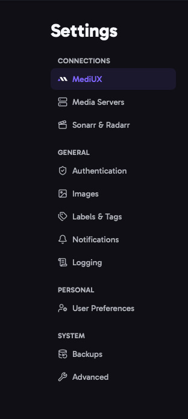

import { Aside, CardGrid, LinkCard } from "@astrojs/starlight/components";

Open **Settings** from the menu to change how aura works. Settings are split into sections, listed on the left (or at the top on a phone).

## How Settings Are Saved

- **Most settings save automatically**, a moment after you change them. The status next to the section title shows **Saving...**, then **Saved**.
- **Connection settings save with Test & Save.** Changing a media server, MediUX token, Sonarr or Radarr connection or notification provider doesn't save until you click **Test & Save**. aura checks that the connection works first, so a typo can't break it.
- **Fix errors to save.** If a value isn't valid, the field is highlighted and the section shows **Fix the errors below to save your changes**. Nothing in that section is saved until it's fixed.
- A highlighted border shows settings you've changed but that aren't saved yet.

Your settings are stored in aura's database, so they apply to every browser and device. You can also set aura up with a [config file](/AURA/config/).

## Sections

<CardGrid>
  <LinkCard title="MediUX" description="Your MediUX token and the quality of downloaded images." href="/AURA/settings/mediux/" />
  <LinkCard title="Media Servers" description="The main media server, and any other media servers aura applies images to." href="/AURA/settings/media-servers/" />
  <LinkCard title="Sonarr & Radarr" description="Sonarr and Radarr instances, used for tags." href="/AURA/settings/sonarr-radarr/" />
  <LinkCard title="Authentication" description="Password and Single Sign-On login, and the API key for integrations." href="/AURA/settings/authentication/" />
  <LinkCard title="Images" description="Image caching, and saving images next to your media." href="/AURA/settings/images/" />
  <LinkCard title="Labels & Tags" description="Labels and tags added to or removed from items when images are applied." href="/AURA/settings/labels-and-tags/" />
  <LinkCard title="Notifications" description="Where aura sends notifications, and what they say." href="/AURA/settings/notifications/" />
  <LinkCard title="Logging" description="How much aura logs, and how long log files are kept." href="/AURA/settings/logging/" />
  <LinkCard title="User Preferences" description="Download defaults, favorite creators and display options." href="/AURA/settings/user-preferences/" />
  <LinkCard title="Backups" description="Backups of the database, with your settings and saved sets." href="/AURA/settings/backups/" />
  <LinkCard title="Advanced" description="Export and import, the debug bundle, debug mode and the app cache." href="/AURA/settings/advanced/" />
</CardGrid>

<Aside>
  Job schedules aren't in Settings. They're on their own [Jobs](/AURA/how-to-use/jobs/) page.
</Aside>
