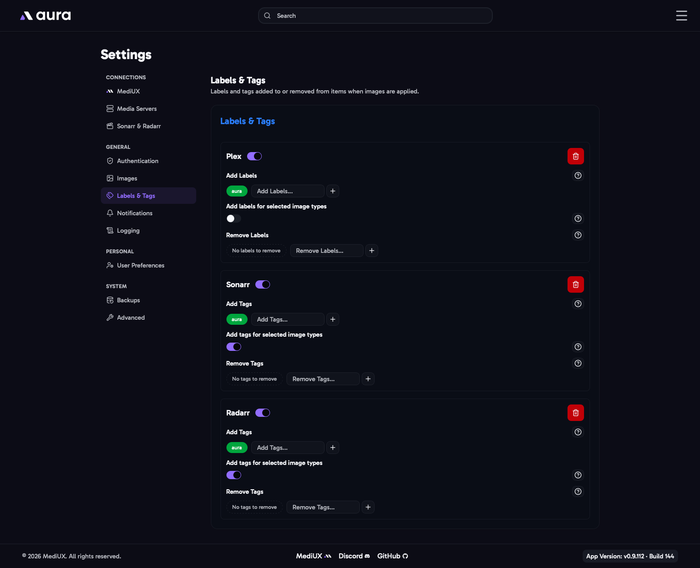

import { Aside } from "@astrojs/starlight/components";



When aura applies images to an item, it can add and remove **labels** in Plex, and **tags** in Sonarr and Radarr. Use them to see which items aura has updated, or to trigger other tools. For example, Kometa can add its overlays to items with a certain label.

Add an app with **Add**. **Plex** is offered when your main media server is Plex, and **Sonarr** and **Radarr** once you've connected them in [Sonarr & Radarr](/AURA/settings/sonarr-radarr/).

## Enabled

Turn an app off to stop changing its labels or tags, without removing its settings.

## Add Labels / Add Tags

Labels or tags to add to each item aura applies images to.

## Remove Labels / Remove Tags

Labels or tags to remove from each item aura applies images to.

## Add Labels / Tags for Selected Image Types

Adds a label or tag for each type of image aura downloaded, in the format `aura-<type>`. Downloading a poster and a backdrop adds `aura-poster` and `aura-backdrop`, so you can see at a glance which images came from aura.

## Remove "Overlay" Label Only on Poster Download (Plex only)

Kometa labels the items it has added overlays to with `Overlay`. Removing the label makes Kometa add its overlays again on its next run, so adding `Overlay` to Plex's **Remove** list puts overlays on the new images aura applies.

With this on, aura only removes `Overlay` when it downloads a **poster** for the item, and leaves it when it only downloads other images, like backdrops or title cards. Turn it on if `Overlay` is in your Plex **Remove** list and you only use Kometa overlays on posters.

<Aside>
  Sonarr and Radarr tags must be lowercase.
</Aside>

## In the Config File

```yaml
LabelsAndTags:
  RemoveOverlayLabelOnlyOnPosterDownload: true
  Applications:
    - Application: Plex
      Enabled: true
      Add:
        - aura
      Remove:
        - Overlay
      AddLabelTagForSelectedTypes: true
    - Application: Sonarr
      Enabled: true
      Add:
        - aura
      Remove: []
      AddLabelTagForSelectedTypes: false
    - Application: Radarr
      Enabled: true
      Add:
        - aura
      Remove: []
```
