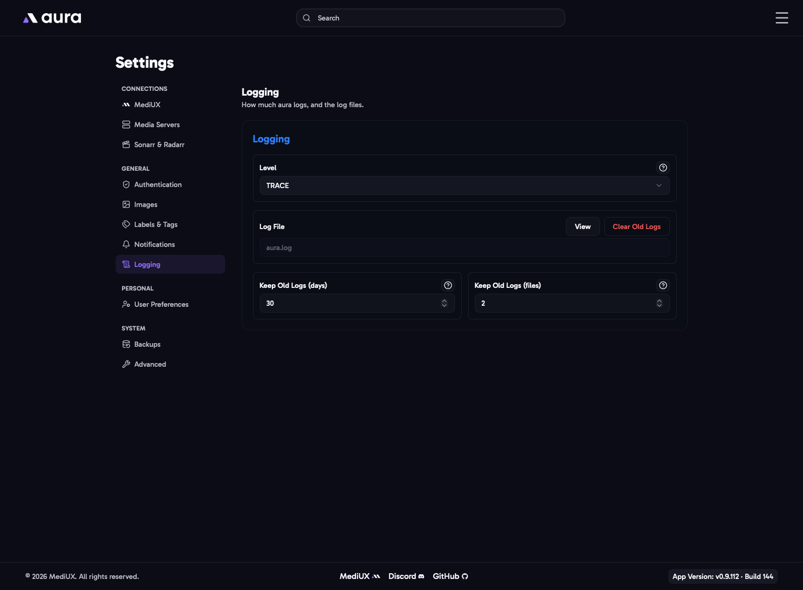

import { Aside } from "@astrojs/starlight/components";



aura writes its logs to `/config/logs`. You can read them on the [Logs](/AURA/how-to-use/logs/) page.

## Level

How much aura logs. Each level includes the ones below it.

| Level     | Logs                                                                          |
| --------- | ----------------------------------------------------------------------------- |
| **TRACE** | Everything, including every step of every action. Very large log files.      |
| **DEBUG** | Detailed information, useful when tracking down a problem.                    |
| **INFO**  | What aura is doing: downloads, jobs and changes. The recommended level.       |
| **WARN**  | Unexpected things that aura worked around.                                    |
| **ERROR** | Only failures.                                                                |

If something isn't working, set the level to **DEBUG** or **TRACE**, try again, then attach a [Debug Bundle](/AURA/settings/advanced/#debug-bundle) to your bug report. Set it back to **INFO** afterwards.

## Log File

**View** opens the [Logs](/AURA/how-to-use/logs/) page. **Clear Old Logs** deletes the old log files and keeps the current one.

## Keep Old Logs

aura starts a new log file when the current one reaches 25 MB, and deletes old files when either limit is reached:

- **Days** (1 to 365, default 7): old log files are deleted after this many days.
- **Files** (1 to 100, default 7): only this many old log files are kept. The oldest are deleted first.

Old files are cleaned up when a new log file starts, so on a quiet install they can stay a little longer than the number of days.

## In the Config File

```yaml
Logging:
  Level: INFO # TRACE, DEBUG, INFO, WARN or ERROR
  KeepDays: 7
  KeepFiles: 7
```
