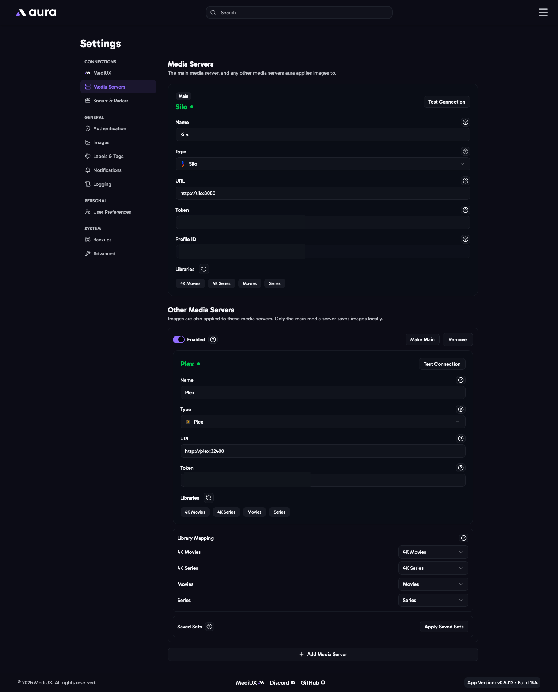

import { Aside } from "@astrojs/starlight/components";



aura works with **Plex**, **Emby**, **Jellyfin** and **Silo**. You choose one **main** media server, and can add any number of **other** media servers.

- **The main media server** is the one you browse in aura. Its libraries are shown on the Home page, and your saved sets belong to its items.
- **Other media servers** get the same images. When aura applies an image, it applies it on the main media server first, then on every other media server that has the same movie or show.

## Main Media Server

### Name

The name shown for this media server in aura. It defaults to the media server type.

### Type

Plex, Emby, Jellyfin or Silo.

### Sign in with Plex

For Plex, the easiest way to connect is **Sign in with Plex**. Log in to your Plex account in the window that opens, then choose your server and how to connect to it:

- **Local**: connects to the server on your network. Use this when aura and Plex are on the same network.
- **Relay**: connects through Plex's relay service. It's slower, so only use it if a local connection doesn't work.

aura fills in the URL and token for you. You can also enter them yourself instead.

### URL

The address of your media server, including `http://` or `https://`. If you use an IP address, include the port, for example `http://192.168.1.10:32400`.

For Silo, use the main Silo server URL, not its Jellyfin compatibility URL.

### Token

The API token aura uses to talk to your media server.

- **Plex**: the Plex token, filled in by Sign in with Plex.
- **Emby and Jellyfin**: create an API key in the server's dashboard, under API Keys.
- **Silo**: create an API key from an admin account, as applying images needs admin access. Silo limits how many requests an API key can make, and aura makes one request per item while it loads your libraries. Set the API key's rate tier to **elevated** in Silo, especially for large libraries. If you still hit the limit, raise the Elevated API Key Rate Limit in Silo under **Admin > Settings > Security & Access**.

### User ID

Emby and Jellyfin need the ID of an admin user, and Silo needs the profile ID of the API key's account. aura finds it automatically once the URL and token work, so you don't need to fill it in.

### Libraries

The movie and show libraries aura manages. Only the libraries you add here are shown in aura. Use the refresh button to load new libraries from the media server.

### Enable "Sort by Episode Added Date" (Plex only)

Adds a **New Episode Added** sort to the Home page, which puts the shows with the newest episodes first. It needs an extra request to Plex for every show, which makes loading large libraries noticeably slower, so it's off by default.

### Enable Plex Websocket Listener (Plex only)

Keeps a connection open to Plex and listens for library refreshes. When Plex refreshes an item's metadata, it can replace your custom images with its own. With this on, aura notices and applies your saved images again straight away. Turn it off if you don't need it or it causes issues.

## Other Media Servers

Add another media server with **Add Media Server**. It has the same fields as the main media server, plus:

### Enabled

Turn a media server off to stop applying images to it, without removing it.

### Library Mapping

Which main media server library each of this server's libraries matches. Images applied to an item in a main server library are also applied to the same item in the matching library here. Libraries with the same name match automatically. Choose **Don't match** for a library aura should leave alone.

### How Items Are Matched

- Items are matched by their TMDB ID, in the libraries that match the item's library on the main media server.
- If the other media server has no matching edition of a movie, the image is applied to its base movie.
- Collection images are only applied on the main media server.
- Ratings are applied on every Plex and Silo media server, and labels on every Plex media server.
- Only the main media server saves images locally, and listens for Plex refreshes.
- A media server that can't be reached is skipped and logged as a warning. It doesn't stop aura or the main media server.

### Apply Saved Sets

Images are only applied to another media server from the moment you add it. To apply the sets you saved before that, use **Apply Saved Sets** on the media server. It runs in the background, shows its progress, and can be cancelled. The main media server can't be changed while it runs.

### Make Main

**Make Main** turns another media server into the main media server.

1. aura first shows what will happen to your saved items, library by library.
2. It then moves them to the new main media server's items. Their saved sets, ignored status and download history move with them.
3. Saved items that aren't on the new main media server are kept, and marked as not on the server.
4. Saved items that become the same item on the new server are merged and keep the sets of both. This happens with two editions of a movie on a server without editions, for example.
5. The library maps change to the new main media server's libraries.

The switch can't happen while downloads are in the queue.

### Remove

Removing a media server stops aura from applying images to it. Images already applied stay on it.

## In the Config File

```yaml
MainMediaServer: a1b2c3d4e5f60718
MediaServers:
  - ID: a1b2c3d4e5f60718
    Name: Plex
    Enabled: true
    Type: Plex
    URL: http://192.168.1.10:32400
    ApiToken: YOUR_PLEX_TOKEN
    Libraries:
      - Title: Movies
      - Title: Series
    EnableSortByEpisodeAddedDate: false
    EnablePlexEventListener: false
  - ID: 9f8e7d6c5b4a3921
    Name: Silo
    Enabled: true
    Type: Silo
    URL: http://192.168.1.10:8090
    ApiToken: YOUR_SILO_API_KEY
    Libraries:
      - Title: Films
      - Title: TV Shows
    LibraryMap:
      Films: Movies
      TV Shows: Series
```

- **`ID`** is created by aura when a media server is added. Keep it the same when you edit a config file, as `MainMediaServer` uses it.
- Change the main media server with **Make Main**, not by editing `MainMediaServer`.

<Aside>
  Config files from older versions of aura have a single `MediaServer` instead of `MediaServers`. They can still be
  imported, and that media server becomes the main media server.
</Aside>
