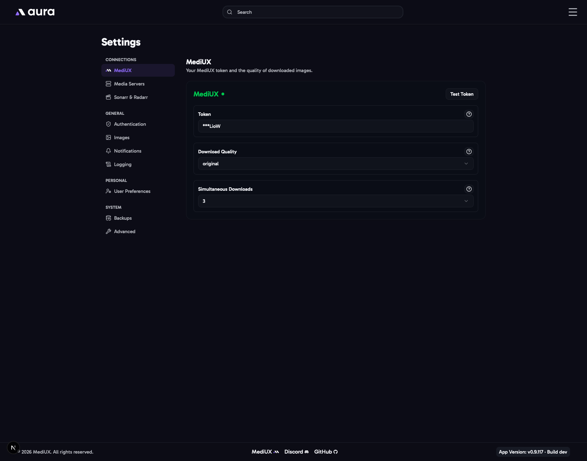

import { Aside } from "@astrojs/starlight/components";



aura gets all of its sets and images from [MediUX](https://mediux.io). This section connects aura to your MediUX account.

## Token

Your personal MediUX API token. aura uses it to search MediUX, load sets and creators, and download images. It also lets aura see who you follow and hide on MediUX, so the creators you follow are listed first and the ones you hide are left out.

Paste the token and click **Test & Save**. The status next to the field shows whether MediUX accepted it.

<Aside title="Getting a token">
  Personal tokens aren't available to everyone yet. To try aura, join the [Discord](https://discord.gg/YAKzwKPwyw)
  and go to **repo-chats > mediux-team/aura**. A pinned message there has a shared token you can use for testing.
  Once the new MediUX site is live, you'll be able to create your own token in your MediUX account settings.
</Aside>

## Download Quality

The quality of the images aura downloads and applies to your media server.

| Option        | What it does                                                                |
| ------------- | --------------------------------------------------------------------------- |
| **Optimized** | Compressed images, smaller and faster to download. This is the default.     |
| **Original**  | The full-quality file the creator uploaded. Larger, and slower to download. |

## Simultaneous Downloads

How many images each download gets at once. The settings page offers 1 to 5, and the default is 3. It's used for every download: the [Download Queue](/AURA/how-to-use/download-queue/), the download window, Auto Download and the rest.

The Download Queue also downloads this many sets at once, each with this many images at once. With 3, that's up to 9 images at a time.

MediUX can take a few seconds to send an image it hasn't sent in a while, so downloading several at once is faster. More at once puts more load on MediUX. If MediUX says aura is sending too many requests, aura waits and tries again.

## In the Config File

```yaml
Mediux:
  ApiToken: YOUR_MEDIUX_API_TOKEN
  DownloadQuality: optimized # optimized or original
  SimultaneousDownloads: 3
```
