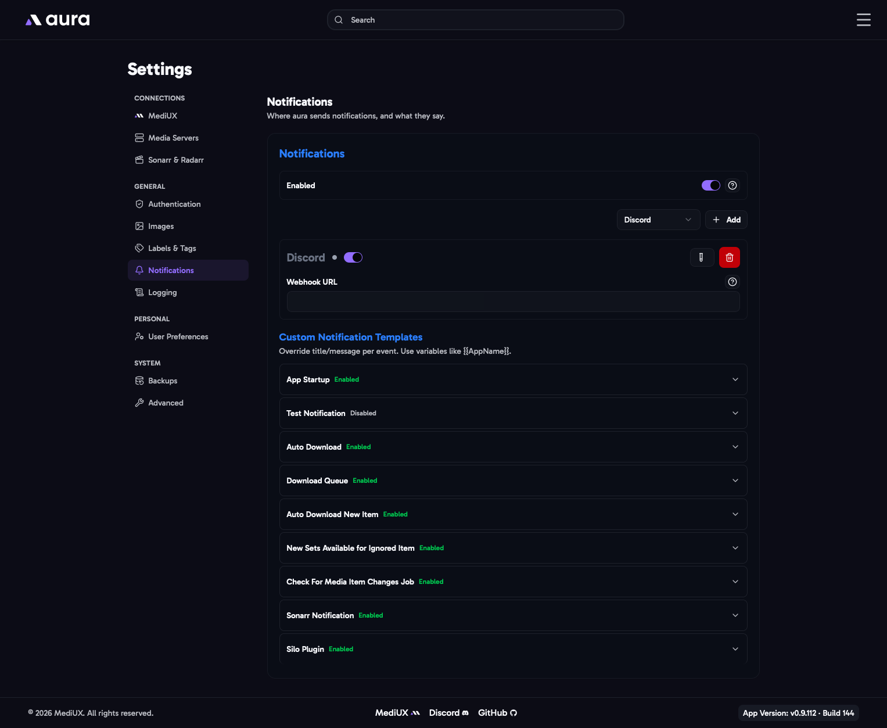

import { Aside } from "@astrojs/starlight/components";



aura can send a notification when it downloads images, finds new sets, starts up, and more.

## Enabled

The main switch for all notifications. Each provider and each notification can also be turned on or off on its own.

## Providers

Add a provider with **Add**, fill in its details, and click **Test & Save**. aura sends a test notification to check that it works. You can add as many providers as you like; every notification is sent to all of the enabled ones.

### Discord

- **Webhook URL**: in your Discord server, open **Server Settings > Integrations > Webhooks**, create a webhook for the channel you want, and copy its URL. It starts with `https://discord.com/api/webhooks/`.

### Pushover

- **User Key**: shown on your [Pushover](https://pushover.net/) dashboard after you log in.
- **App Token**: create an application under **Your Applications** in Pushover, and copy its token.

### Gotify

- **URL**: the address of your Gotify server, for example `https://gotify.example.com` or `http://192.168.1.10:8070`. An IP address needs a port.
- **App Token**: create an app under **Apps** in Gotify, and copy its token.

### Custom Webhook

- **URL**: aura sends each notification to this address as a `POST` request with a JSON body. `image_url` is only included when the notification has an image:

  ```json
  { "title": "Alien (1979)", "message": "Poster downloaded", "image_url": "https://..." }
  ```

- **Custom Headers**: headers to send with each request, for example an `Authorization` header for a service that needs one.

## Notification Templates

Each kind of notification has a template. Turn a notification off to stop sending it, or change its **Title** and **Message**. Use the **+** button next to a field to add a variable, such as `{{MediaItemTitle}}` or `{{SetCreator}}`. Each notification lists only the variables it supports. **Include Image** attaches the image, or the item's poster, where the notification has one.

If you change a template and want the original back, click **Restore Default**.

| Notification                           | Sent when                                                                                                   |
| -------------------------------------- | ----------------------------------------------------------------------------------------------------------- |
| **App Startup**                        | aura starts.                                                                                                |
| **Test Notification**                  | You test a provider.                                                                                        |
| **Auto Download**                      | The Auto Download job downloads a new or updated image for one of your saved sets.                          |
| **Download Queue**                     | A set in the [Download Queue](/AURA/how-to-use/download-queue/) finishes downloading.                       |
| **Auto Download New Item**             | A set from one of your [favorite creators](/AURA/settings/user-preferences/#favorite-creators--automatic-downloads) is downloaded for a new item. |
| **New Sets Available for Ignored Item** | An item you ignored until a set is available now has sets on MediUX.                                       |
| **Check For Media Item Changes Job**   | A saved item has changed or can no longer be found on your media server.                                    |
| **Sonarr Notification**                | The [Sonarr webhook](/AURA/sonarr-webhook-integration/) downloads title cards for an upgraded episode.      |
| **Silo Plugin**                        | A set chosen in Silo with aura's Silo plugin is downloaded. Only shown when you have a Silo media server.   |

## In the Config File

```yaml
Notifications:
  Enabled: true
  Providers:
    - Provider: Discord
      Enabled: true
      Discord:
        Webhook: https://discord.com/api/webhooks/...
    - Provider: Pushover
      Enabled: true
      Pushover:
        UserKey: YOUR_PUSHOVER_USER_KEY
        ApiToken: YOUR_PUSHOVER_APP_TOKEN
    - Provider: Gotify
      Enabled: true
      Gotify:
        URL: https://gotify.example.com
        ApiToken: YOUR_GOTIFY_APP_TOKEN
    - Provider: Webhook
      Enabled: true
      Webhook:
        URL: https://example.com/webhook
        Headers:
          Authorization: Bearer YOUR_TOKEN
  NotificationTemplate:
    AutoDownload:
      Enabled: true
      Title: "{{MediaItemTitle}} ({{MediaItemYear}})"
      Message: "{{ReasonTitle}}{{NewLine}}{{Reason}}"
      IncludeImage: true
```

Templates you leave out use their defaults. The other template names are `AppStartup`, `TestNotification`, `DownloadQueue`, `NewItemAutoDownload`, `NewSetsAvailableForIgnoredItems`, `CheckForMediaItemChangesJob`, `SonarrNotification` and `SiloPlugin`.

<Aside>
  `Provider` is case-sensitive: use `Discord`, `Pushover`, `Gotify` or `Webhook`.
</Aside>
