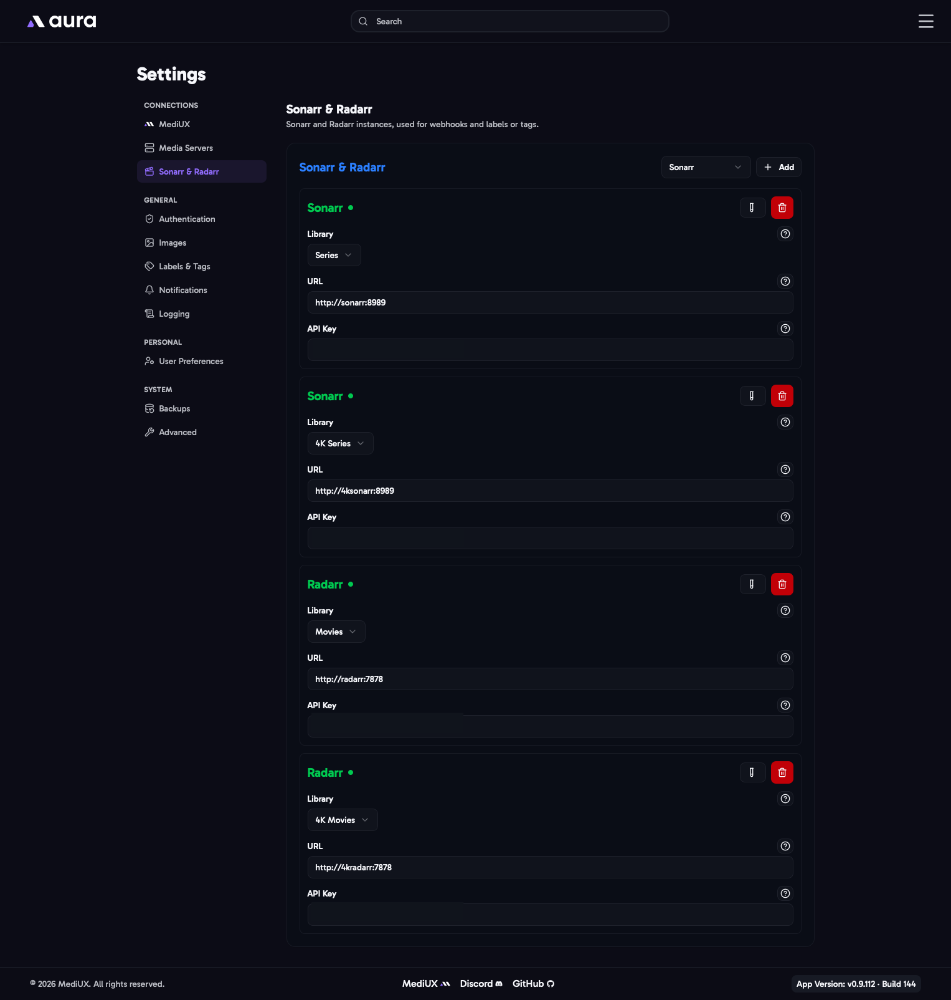

import { Aside } from "@astrojs/starlight/components";



Connecting Sonarr and Radarr is optional. aura uses them to add or remove **tags** on your Sonarr series and Radarr movies when it applies images. Set the tags up in [Labels & Tags](/AURA/settings/labels-and-tags/).

<Aside>
  The [Sonarr webhook](/AURA/sonarr-webhook-integration/), which applies title cards again when Sonarr upgrades an
  episode, works without adding Sonarr here.
</Aside>

Add an instance with **Add**, choose **Sonarr** or **Radarr**, fill in its details, and click **Test & Save**.

## Library

The main media server library this instance manages. aura uses it to know which Sonarr or Radarr instance to tag an item in. If you have separate instances for HD and 4K, add each one with its own library.

## URL

The address of Sonarr or Radarr, including `http://` or `https://`. If you use an IP address, include the port, for example `http://192.168.1.10:8989`.

## API Key

Sonarr's or Radarr's API key. Find it in Sonarr or Radarr under **Settings > General > Security**.

<Aside>
  Before you can add an instance, set up your main media server, so aura knows its libraries.
</Aside>

## In the Config File

```yaml
SonarrRadarr:
  Applications:
    - Type: Sonarr
      Library: Series
      URL: http://192.168.1.10:8989
      ApiToken: YOUR_SONARR_API_KEY
    - Type: Sonarr
      Library: 4K Series
      URL: http://192.168.1.10:8990
      ApiToken: YOUR_SONARR_4K_API_KEY
    - Type: Radarr
      Library: Movies
      URL: http://192.168.1.10:7878
      ApiToken: YOUR_RADARR_API_KEY
```
