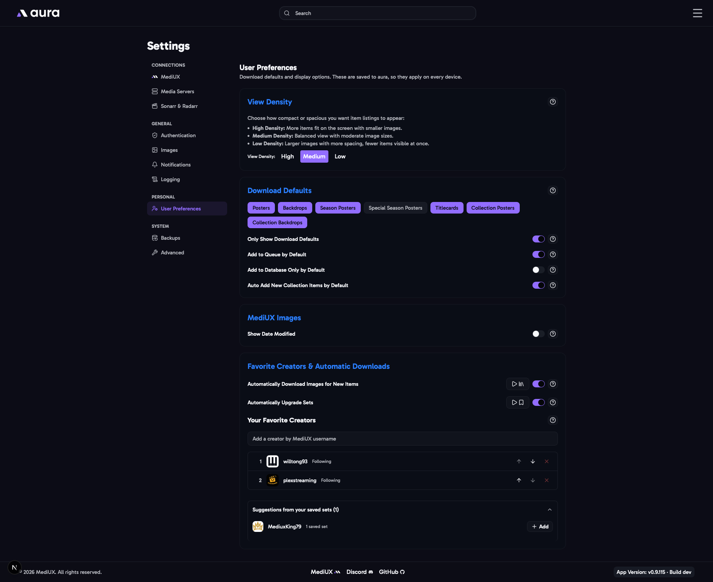

import { Aside } from "@astrojs/starlight/components";



User preferences are saved in aura, not in your browser, so they're the same on every device. Only View Density is saved separately in each browser. aura also remembers the sort and filter options you choose on each page, like Home, Saved Sets and the Download Queue, and uses them on every device.

## View Density

How large the posters are in lists and carousels.

- **High**: smaller images, more items on screen.
- **Medium**: a balance of both.
- **Low**: larger images, fewer items on screen.

## Download Defaults

The image types that are already checked when you open the [download window](/AURA/how-to-use/downloading-sets/): Poster, Backdrop, Season Poster, Special Season Poster, Title Card, Collection Poster and Collection Backdrop. Click a badge to turn it on or off. You can still change them for each download.

Collection Poster and Collection Backdrop are the collection's own images, offered for collection sets on a movie's page.

Download defaults are also used for sets that aura downloads by itself, from your favorite creators.

## Only Show Download Defaults

Only shows sets that have at least one of your download default image types. For example, if your only default is Title Card, sets without title cards are hidden. You can also change this in the filters on a Media Item page.

## Add to Queue by Default

Checks **Add to Queue** when you open the download window, so sets go to the [Download Queue](/AURA/how-to-use/download-queue/) instead of downloading straight away. You can still uncheck it for each download.

## Add to Database Only by Default

Checks **Add to Database Only** for each item when you open the download window, so sets are saved without downloading any images. Useful if you've already applied most of your images some other way. You can still uncheck it for each download.

## Auto Add New Collection Items by Default

Checks **Auto Add New Collection Items** when you open the download window for a collection set. Movies added to the collection later then get their images from the set automatically. You can still uncheck it for each download.

## Show Date Modified

Shows the date each image was last changed on MediUX, under the image.

## Favorite Creators & Automatic Downloads

Your favorite creators are the MediUX creators whose sets you like best. aura can use them to download sets for you.

### Your Favorite Creators

Your favorite creators, ranked best first: rank 1 is your top creator. Use the arrows to change the order, and add a creator by their MediUX username.

Creators you follow on MediUX are always favorites. To remove one of them, unfollow them on MediUX.

### Automatically Download Images for New Items

When a new movie or show is added to your libraries, aura looks for a set from your favorite creators, starting with your top creator. If it finds one, it saves the set and adds it to the [Download Queue](/AURA/how-to-use/download-queue/), using your download defaults.

The **play button** does the same for every movie and show already in your libraries that doesn't have a saved set yet. On a large library that can be a lot of downloads.

### Automatically Upgrade Sets

The **Upgrade Saved Sets** job checks your saved sets against your favorite creators. When a creator ranked higher than a set's creator has a set for the item, the new set replaces it:

- Any favorite creator ranks above creators who aren't favorites.
- The new set uses your download defaults, with Auto Download on, and is added to the Download Queue.
- The old set is removed once the new one is saved.
- Sets with **Auto Upgrade** turned off are never replaced. Turn it off in the download window, or when you edit a saved set.

The **play button** runs the upgrade now. You can also upgrade chosen sets from the [Saved Sets](/AURA/how-to-use/saved-sets/) page.

<Aside>
  Turn on at least one of the automatic options to choose your favorite creators.
</Aside>

## In the Config File

```yaml
UserPreferences:
  DownloadDefaults:
    - poster
    - backdrop
    - season_poster
    - special_season_poster
    - titlecard
    - collection_poster
    - collection_backdrop
  ShowOnlyDownloadDefaults: false
  ShowDateModified: false
  DefaultAddToQueue: false
  DefaultAddToDBOnly: false
  DefaultAutoAddNewCollectionItems: false
  AutoDownloadNewItems: false
  AutoUpgradeSets: false
  FavoriteCreators:
    - creator-one
    - creator-two
```

View density is saved in your browser, not the config file.
